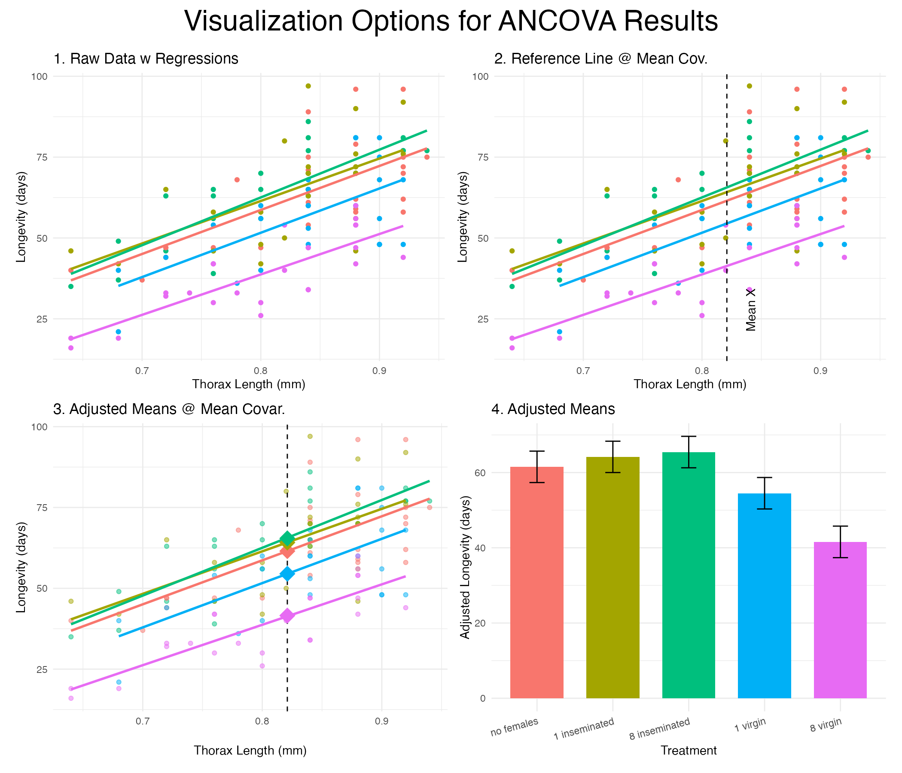

---
metadata-files:
  - ../../_templates/_lectures.yml
title: "Lecture: ANCOVA — Analysis of Covariance"
subtitle: "Covariates"
description: "Analysis of covariance mixing continuous and categorical predictors — the ANCOVA workflow, testing homogeneity of slopes, adjusted means, a worked fruitfly-longevity example, handling heterogeneous slopes, and robust alternatives."
categories: [ANOVA, Regression]
order: 17
week: 12
author: "Bill Perry"

knitr:
  opts_chunk:
    paged.print: false
    collapse: true
format:
  html:
    downloads: [docx, pptx]  # This creates download links for all three
  revealjs:
    output-ext: "slides.html"
  docx:
    reference-doc: ../../ms_templates/custom-reference-compact.docx
    fig-width: 2.5
    fig-height: 2.5
    fig-dpi: 300
    dpi: 300            # tell Pandoc the real render dpi so it sizes figures correctly
  pptx: default
execute:
  echo: true
---

```{r setup}
#| include: false
#| message: false
#| warning: false
# install.packages("interactions")
library(interactions)
library(car)
library(emmeans)
library(patchwork)
library(broom)
library(gridExtra)
library(tidyverse)

library(janitor)

# for type 3 anova
options(contrasts = c("contr.sum", "contr.poly")) # for true type 3 anovas
options(scipen = 999)

# ---- Arctic grayling, lakes I3 and I8 (week 5 data, new question) ----
g_df <- read_csv("data/gray_I3_I8.csv", show_col_types = FALSE) %>%
  clean_names() %>%
  filter(mass_g > 0) %>%
  mutate(log_len  = log10(length_mm),
         log_mass = log10(mass_g))

# ---- Partridge & Farquhar fruitflies -- Quinn & Keough Box 12-1 ----
# Same code as the activity. Labels come from partners + type, NOT the
# treatmen codes (1 = 8 inseminated, 2 = none, 3 = 1 inseminated,
# 4 = 1 virgin, 5 = 8 virgin) -- guessing those reverses the result.
p_df <- read_csv("data/partridge.csv", show_col_types = FALSE) %>%
  clean_names() %>%
  mutate(
    treat = factor(
      case_when(
        partners == 0               ~ "no females",
        partners == 1 & type == 0   ~ "1 inseminated",
        partners == 8 & type == 0   ~ "8 inseminated",
        partners == 1 & type == 1   ~ "1 virgin",
        partners == 8 & type == 1   ~ "8 virgin"
      ),
      levels = c("no females", "1 inseminated", "8 inseminated",
                 "1 virgin", "8 virgin")
    )
  )
```

## Part 1 · From GLMs to ANCOVA {.divider}

## Where We Left Off

:::::: columns
::: {.column width="55%"}
Covered last time — **linear mixed models**:

- Fixed vs. random effects, and `(1|group)` notation
- Variance components, the ICC, and partial pooling
- REML instead of partitioning sums of squares

Covered in week 10 — **generalized** linear models:

- Distribution, predictors, link
- Poisson, negative binomial, logistic
:::

:::: {.column width="45%"}
::: callout-note
**✅ Where today fits**

Week 10 changed the **distribution**. Week 11 changed the **error structure**. Today changes neither — it goes back to the ordinary linear model and asks what happens when the predictors are **one categorical and one continuous at the same time**.

This is the last of the general linear models, and the one that links the ANOVA half of the course to the regression half.
:::
::::
::::::

## ANCOVA Overview

**Overview**

- Analysis of covariance (ANCOVA):
  - Introduction to ANCOVA

  - The ANCOVA workflow in R

  - When to use ANCOVA

  - Building the ANCOVA model in R

  - Assumptions of ANCOVA

    - Homogeneity of slopes (The critical test!)

  - Interpreting results & "Adjusted Means"

  - Handling violations (heterogeneous slopes)

## Introduction to ANCOVA

::::: columns
::: {.column width="60%"}
**ANCOVA = Analysis of COVAriance** — regression and ANOVA in one model. You use it when you have:

- a **continuous response** (Y)
- a **categorical predictor** (factor A)
- a **continuous predictor**, the **covariate** (X)

**Two things it is for:**

1.  Compare group means **after adjusting** for the covariate
2.  Ask whether two or more **regression lines** differ — in slope, in intercept, or both
:::

::: {.column width="40%"}
```{r l15-02}
#| out-width: "100%"
#| echo: false
#| message: false
#| warning: false
#| paged-print: false
#| fig-alt: "Scatterplot of a simulated response variable Y against covariate X, colored by three groups (A, B, C), with a separate fitted regression line for each group, illustrating the setup ANCOVA is designed to analyze."

# Create a simple dataset to illustrate ANCOVA
set.seed(123)
n <- 60
group <- rep(c("A", "B", "C"), each = n / 3)
x <- rnorm(n, mean = 5, sd = 1.5)
y <- 2 +
  0.8 * x +
  ifelse(group == "A", 2, ifelse(group == "B", 1, 0)) +
  rnorm(n, sd = 1)
data <- data.frame(group = group, x = x, y = y)

# Plot with regression lines by group
ggplot(data, aes(x = x, y = y, color = group)) +
  geom_point(alpha = 0.7) +
  geom_smooth(method = "lm", se = FALSE) +
  theme_minimal(base_size = 9) +
  labs(
    title = "ANCOVA: Regression Lines by Group",
    x = "Covariate (X)",
    y = "Response Variable (Y)",
    color = "Group"
  ) +
  theme(legend.position = "bottom")
```
:::
:::::

## When to Use ANCOVA

Three reasons, and the next slides take them one at a time:

1.  **Power.** The covariate soaks up residual "noise," so the test of the factor gets stronger. *(the fruitflies)*
2.  **Confounding.** The groups sit at different covariate values, so raw means mislead. ANCOVA compares them at a **common** covariate value.
3.  **Comparing regression lines.** Do the groups share a slope at all? *(the grayling)*

## The Motivating Problem — Grayling in Two Lakes

::::: columns
::: {.column width="50%"}
Back to the Arctic grayling from **week 5** — the same fish, a new question.

Lake **I8** fish weigh more than lake **I3** fish. But I8 fish are also **longer** (mean 364 mm vs 266 mm).

> **Is there a lake effect on mass at all, or are I8 fish simply bigger?**

You cannot answer that by comparing mean masses. The groups differ in the very thing that drives the response.
:::

::: {.column width="50%"}
```{r l15-03}
#| out-width: "100%"
#| echo: false
#| message: false
#| warning: false
#| paged-print: false
#| fig-height: 3.2
#| fig-width: 3.8
#| fig-alt: "Scatterplot of grayling mass against length on log-log axes, colored by lake, with a fitted regression line per lake. The I3 fish occupy the shorter end of the length range and sit slightly below the I8 line."

ggplot(g_df, aes(log_len, log_mass, color = lake)) +
  geom_point(alpha = 0.6, size = 1.6) +
  geom_smooth(method = "lm", se = FALSE) +
  labs(x = "log10 length (mm)", y = "log10 mass (g)", color = "Lake") +
  theme_minimal(base_size = 9) +
  theme(legend.position = "bottom")
```
:::
:::::

## Two Problems, One Tool

::::::: columns
::: {.column width="50%"}
**Problem 1 — confounding.** The groups differ in the covariate, so a raw comparison of means confuses the treatment with the covariate. This is the grayling problem.

**Problem 2 — noise.** Even when the groups *are* balanced on the covariate, the covariate still soaks up residual variation. Removing it shrinks the error term and makes the test of the factor **more powerful**. This is the fruitfly problem in Part 4.
:::

::::: {.column width="50%"}
::: callout-important
**ANCOVA does both with one model**

$$y \sim \underbrace{x}_{\text{covariate}} + \underbrace{A}_{\text{factor}}$$

It compares groups **at a common value of the covariate** — the "level playing field" comparison — instead of wherever each group happened to sit.
:::

::: callout-warning
**⚠️ One rule before you start**

The covariate must be measured **independently of the treatment**, and must not be **affected** by it. Adjusting for something the treatment caused removes the very effect you are trying to measure.
:::
:::::
:::::::

## Part 2 · The ANCOVA Model {.divider}

## Raw Means vs Adjusted Means

::::: columns
::: {.column width="38%"}
The key idea in ANCOVA is the difference between **raw** and **adjusted** group means.

- **Stars: raw means.** Each group's average X and average Y. The two groups sit at different X, so comparing their Ys mixes the group effect up with the covariate.
- **Diamonds: adjusted means.** Slide each raw mean **along its own line** (dashed) to one shared X, the overall mean of the covariate (dotted line).
- ANCOVA compares the **heights of the diamonds**: each group's predicted Y *if every group had the same covariate value*.
:::

::: {.column width="62%"}
```{r l15-04}
#| fig-width: 5.5
#| fig-height: 4.4
#| out-width: "100%"
#| echo: false
#| message: false
#| warning: false
#| paged-print: false
#| fig-alt: "Diagram of two group regression lines with raw group means marked as asterisks and 'adjusted means' marked as diamonds at the overall mean covariate value, with dashed segments showing how each raw mean is projected along its regression line to the adjusted mean, illustrating how ANCOVA levels the playing field across differing covariate values."
# Create diagram showing how ANCOVA works
set.seed(789)
x_range <- seq(2, 8, length.out = 100)
group_a <- data.frame(
  x = x_range,
  y = 2 + 0.7 * x_range,
  group = "Group A"
)
group_b <- data.frame(
  x = x_range,
  y = 5 + 0.7 * x_range,
  group = "Group B"
)
model_data <- rbind(group_a, group_b)

# Add points
set.seed(789)
points_a <- data.frame(
  x = runif(10, 2.2, 5.5),
  group = "Group A"
)
points_a$y <- 2 + 0.7 * points_a$x + rnorm(10, 0, 0.5)

points_b <- data.frame(
  x = runif(10, 4.5, 7.8),
  group = "Group B"
)
points_b$y <- 5 + 0.7 * points_b$x + rnorm(10, 0, 0.5)

points <- rbind(points_a, points_b)

# Calculate means for the groups
mean_x_a <- mean(points_a$x)
mean_y_a <- mean(points_a$y)
mean_x_b <- mean(points_b$x)
mean_y_b <- mean(points_b$y)
overall_mean_x <- mean(c(points_a$x, points_b$x))

# Calculate adjusted means
adjusted_y_a <- mean_y_a - 0.7 * (mean_x_a - overall_mean_x)
adjusted_y_b <- mean_y_b - 0.7 * (mean_x_b - overall_mean_x)

# Create the plot
ggplot() +
  # Add regression lines
  geom_line(
    data = model_data,
    aes(x = x, y = y, color = group),
    linewidth = 1
  ) +

  # Add points
  geom_point(
    data = points,
    aes(x = x, y = y, color = group),
    size = 3,
    alpha = 0.7
  ) +

  # Add mean x and y for each group
  geom_point(
    aes(x = mean_x_a, y = mean_y_a),
    color = "darkred",
    size = 5,
    shape = 8
  ) +
  geom_point(
    aes(x = mean_x_b, y = mean_y_b),
    color = "darkblue",
    size = 5,
    shape = 8
  ) +

  # Add adjusted means at overall mean x triangle
  geom_point(
    aes(x = overall_mean_x, y = adjusted_y_a),
    color = "#F8766D",
    size = 5,
    shape = 18
  ) +
  geom_point(
    aes(x = overall_mean_x, y = adjusted_y_b),
    color = "#00BFC4",
    size = 5,
    shape = 18
  ) +

  # Add vertical lines to show adjustment
  geom_segment(
    aes(x = mean_x_a, y = mean_y_a, xend = overall_mean_x, yend = adjusted_y_a),
    color = "#F8766D",
    linetype = "dashed"
  ) +
  geom_segment(
    aes(x = mean_x_b, y = mean_y_b, xend = overall_mean_x, yend = adjusted_y_b),
    color = "#00BFC4",
    linetype = "dashed"
  ) +

  # Add vertical line at overall mean x
  geom_vline(xintercept = overall_mean_x, linetype = "dotted") +

  # Labels
  annotate(
    "text",
    x = mean_x_a - 0.2,
    y = mean_y_a + 1,
    label = "Group A\nMean",
    color = "darkred"
  ) +
  annotate(
    "text",
    x = mean_x_b + 0.1,
    y = mean_y_b + 1,
    label = "Group B\nMean",
    color = "darkblue"
  ) +
  annotate(
    "text",
    x = overall_mean_x + .4,
    y = adjusted_y_a - 0.5,
    label = "Adjusted\nMean A",
    color = "#F8766D"
  ) +
  annotate(
    "text",
    x = overall_mean_x + .2,
    y = adjusted_y_b - 0.8,
    label = "Adjusted\nMean B",
    color = "#00BFC4"
  ) +

  # Theme
  theme_minimal(base_size = 9) +
  labs(
    title = "ANCOVA: Adjusting Means Based on Covariate",
    x = "Covariate (X)",
    y = "Response Variable (Y)",
    color = "Group"
  ) +
  theme(legend.position = "bottom")
```
:::
:::::

## Mathematical Model for ANCOVA

- Single-factor ANCOVA with
  - factor A (p levels, i = 1 to p), a continuous covariate (x), and response variable (y): $Y_{ij} = \mu + \alpha_i + \beta(X_{ij} - \bar{X}) + \varepsilon_{ij}$
- Where:
  - $Y_{ij}$ = response value for observation j in level i of factor A
  - $\mu$ = overall mean
  - $\alpha_i$ = effect of level i of factor A (what we test in ANOVA)
  - $\beta$ = common regression slope relating Y to X (what we test in Regression)
  - $X_{ij}$ = covariate value for observation j in level i of factor A
  - $\bar{X}$ = mean value of covariate
  - $\varepsilon_{ij}$ = error term

## ANCOVA Parameters Interpretation

::::: columns
::: {.column width="60%"}
- **Interpretation of Parameters**
  - $\mu$ = overall mean response
  - $\alpha_i$ = effect of level i (difference between group's adjusted mean and overall mean)
  - $\beta$ = pooled within-group regression coefficient (the slope)
  - $X_{ij}$ = covariate value for observation j in group i
  - $\bar{X}$ = overall mean of covariate
  - $\varepsilon_{ij}$ = unexplained error
- **Model assumes homogeneous slopes** (i.e., $\beta$ same for all groups) .
:::

::: {.column width="40%"}
```{r l15-05}
#| fig-width: 4.2
#| fig-height: 3.8
#| out-width: "100%"
#| echo: false
#| message: false
#| warning: false
#| paged-print: false
#| fig-alt: "Scatterplot of simulated data for two groups with fitted regression lines, a dashed horizontal line marking the overall mean (mu), and text labels showing each group's alpha effect and the common slope beta, illustrating how ANCOVA model parameters map onto the data."
# Create simple dataset to illustrate parameters
set.seed(321)
n <- 20
group <- rep(c("Group 1", "Group 2"), each = n / 2)
x <- rnorm(n, mean = 5, sd = 1.2)
y <- 10 +
  ifelse(group == "Group 1", 2, -2) +
  0.8 * (x - mean(x)) +
  rnorm(n, sd = 0.8)
param_data <- data.frame(group = group, x = x, y = y)

# Calculate overall mean
mu <- mean(y)
# Calculate group means
means_by_group <- aggregate(y ~ group, data = param_data, mean)
# Calculate effect of group 1
alpha_1 <- means_by_group$y[1] - mu
# Calculate effect of group 2
alpha_2 <- means_by_group$y[2] - mu

# Fit the model to get beta
model <- lm(y ~ group + x, data = param_data)
beta <- coef(model)["x"]

# Create plot
ggplot(param_data, aes(x = x, y = y, color = group)) +
  geom_point() +
  geom_smooth(method = "lm", se = FALSE) +
  geom_hline(yintercept = mu, linetype = "dashed", color = "black") +
  annotate(
    "text",
    x = max(x),
    y = mu + 0.2,
    label = "μ (overall mean)",
    hjust = 1
  ) +
  annotate(
    "text",
    x = min(x) + 0.4,
    y = mu + alpha_1,
    label = paste("α1 =", round(alpha_1, 2)),
    color = "#F8766D"
  ) +
  annotate(
    "text",
    x = min(x) + 0.4,
    y = mu + alpha_2,
    label = paste("α2 =", round(alpha_2, 2)),
    color = "#00BFC4"
  ) +
  annotate(
    "text",
    x = mean(x) + 1,
    y = min(y),
    label = paste("β =", round(beta, 2)),
    color = "black"
  ) +
  theme_minimal(base_size = 9) +
  labs(x = "Covariate (X)", y = "Response (Y)") +
  theme(legend.position = "bottom")
```
:::
:::::

## Where Along X Are the Groups Compared?

```{r l15-05c-setup}
#| include: false
cmp_model <- lm(longev ~ thorax + treat, data = p_df)
cmp_xbar  <- mean(p_df$thorax)
cmp_at0   <- as.data.frame(emmeans(cmp_model, ~ treat, at = list(thorax = 0)))
cmp_atbar <- as.data.frame(emmeans(cmp_model, ~ treat))
```

:::::: columns
::: {.column width="45%"}
A regression intercept is the line's height at **x = 0**. `lm()` builds an ANCOVA the same way, so its group coefficients describe the fruitflies at **thorax = 0 mm**: a fly with no thorax, predicted to live about **`r round(mean(cmp_at0$emmean))` days**.

That is why the textbook model writes $\beta(X_{ij} - \bar{X})$. **Centering** moves "zero" to the mean thorax length, `r round(cmp_xbar, 2)` mm, so $\mu + \alpha_i$ becomes each group's **adjusted mean** (the diamonds).

**With parallel lines this does not change the test.** Two parallel lines are the same distance apart at every x, so the treatment *F* is 21.75 whether or not you center. Only the meaning of the intercepts changes, and `emmeans()` reports the groups at the mean of x for you.
:::

:::: {.column width="55%"}
```{r l15-05c}
#| echo: false
#| fig-width: 4.8
#| fig-height: 3.1
#| out-width: "100%"
#| fig-alt: "Fruitfly longevity against thorax length with the five parallel ANCOVA lines extended back to thorax = 0. At zero the lines sit near -50 days, far below any data; at the mean thorax length they pass through the adjusted means, which lie among the data. The vertical gaps between lines are the same at both places."
cmp_lines <- expand_grid(
  thorax = seq(0, max(p_df$thorax), length.out = 60),
  treat  = factor(levels(p_df$treat), levels = levels(p_df$treat))
)
cmp_lines$longev <- predict(cmp_model, newdata = cmp_lines)
cmp_lines$part <- ifelse(cmp_lines$thorax < min(p_df$thorax),
                         "extrapolated", "data")

ggplot(cmp_lines, aes(thorax, longev, colour = treat)) +
  geom_hline(yintercept = 0, colour = "grey70") +
  geom_point(data = p_df, size = 0.8, alpha = 0.5) +
  geom_line(aes(linetype = part), linewidth = 0.7, show.legend = FALSE) +
  scale_linetype_manual(values = c(data = "solid", extrapolated = "dashed")) +
  geom_vline(xintercept = cmp_xbar, linetype = "dotted") +
  geom_point(data = cmp_at0, aes(x = 0, y = emmean), shape = 21,
             fill = "white", size = 2.2, stroke = 1) +
  geom_point(data = cmp_atbar, aes(x = cmp_xbar, y = emmean), shape = 18,
             size = 3.5) +
  annotate("text", x = 0.02, y = 20, hjust = 0, size = 2.8,
           label = "x = 0: what the raw\ncoefficients describe") +
  annotate("text", x = cmp_xbar - 0.02, y = 98, hjust = 1, size = 2.8,
           label = "mean thorax:\nadjusted means") +
  labs(x = "Thorax length (mm)", y = "Longevity (days)", colour = NULL) +
  theme_minimal(base_size = 9) +
  theme(legend.position = "bottom")
```

::: callout-warning
**Non-parallel lines are different.** In `lm(y ~ x * A)` the `A` row tests the gap **at x = 0**. More in Part 4.
:::
::::
::::::

## Building the ANCOVA Model in R

ANCOVA is just the two `lm()` models you already know, added together.

::: compact-table
| Model                   | Formula         | Predictors             |
|-------------------------|-----------------|------------------------|
| Regression              | `lm(y ~ x)`     | one continuous         |
| One-way ANOVA           | `lm(y ~ A)`     | one factor             |
| **ANCOVA, slopes test** | `lm(y ~ x * A)` | both, **plus** `x:A`   |
| **ANCOVA, additive**    | `lm(y ~ x + A)` | both, one shared slope |
:::

`x * A` is shorthand for `x + A + x:A`. The `x:A` term asks one question: **do the groups have different slopes?**

## The ANCOVA Recipe

:::::: columns
::: {.column width="58%"}
``` r
# 1 Plot it - one line per group
ggplot(df, aes(x = x, y = y, color = A)) +
  geom_point() +
  geom_smooth(method = "lm", se = FALSE)

# 2 Test the slopes - look at the x:A row
slopes_model <- lm(y ~ x * A, data = df)
Anova(slopes_model, type = 3)

# 3a x:A NOT significant - drop it
ancova_model <- lm(y ~ x + A, data = df)
Anova(ancova_model, type = 2)
emmeans(ancova_model, ~ A)        # adjusted means

# 3b x:A significant - keep it, report slopes
emtrends(slopes_model, ~ A, var = "x")
```
:::

:::: {.column width="42%"}
::: callout-important
**Step 2 decides everything.**

- *p* \> 0.05 → slopes are parallel → fit the additive model and compare **adjusted means** (3a)
- *p* \< 0.05 → slopes differ → there is no single group difference. **The slopes are the result** (3b)
:::

Check the residuals on whichever model you end up reporting.

This same recipe sits at the top of today's script skeleton.
::::
::::::

## Part 3 · Partitioning Variance & the ANOVA Table {.divider}

## Three Models: Null, Covariate, Full {.nostretch}

```{r l15-05b-setup}
#| include: false
# Sequential split: thorax first, then treat given thorax.
# These are the pieces anova() reports, and they add exactly to SS_total.
ss_gm     <- mean(p_df$longev)
ss_fit_x  <- fitted(lm(longev ~ thorax, data = p_df))          # one common line
ss_fit_xa <- fitted(lm(longev ~ thorax + treat, data = p_df))  # five parallel lines
ss_tot <- sum((p_df$longev - ss_gm)^2)
ss_x   <- sum((ss_fit_x - ss_gm)^2)
ss_a   <- sum((ss_fit_xa - ss_fit_x)^2)
ss_res <- sum((p_df$longev - ss_fit_xa)^2)
ss_x3  <- Anova(lm(longev ~ thorax + treat, data = p_df), type = "III")["thorax", "Sum Sq"]
ss_res_oneway <- deviance(lm(longev ~ treat, data = p_df))
ss_fmt <- function(v) format(round(v), big.mark = ",")
# Type III table for the ANOVA-table slide
ss_t3 <- Anova(lm(longev ~ thorax + treat, data = p_df), type = "III")
ss_ms_res <- ss_t3["Residuals", "Sum Sq"] / ss_t3["Residuals", "Df"]
```

Each model adds **one term** to the one before it. Grey segments show how far each fly sits from what that model predicts.

```{r l15-05m}
#| echo: false
#| fig-width: 9
#| fig-height: 1.95
#| out-width: "100%"
#| fig-alt: "Three panels of fruitfly longevity against thorax length. Null model: a flat line at the grand mean with long residual segments. Covariate model: one sloped line with shorter segments. Full model: five parallel coloured lines with the shortest segments."
mod_df <- bind_rows(
  p_df %>% mutate(fit = ss_gm, model = "Null:  longev ~ 1"),
  p_df %>% mutate(fit = ss_fit_x, model = "Covariate:  longev ~ thorax"),
  p_df %>% mutate(fit = ss_fit_xa, model = "Full:  longev ~ thorax + treat")
) %>%
  mutate(model = fct_inorder(model),
         line_group = ifelse(str_detect(model, "Full"),
                             as.character(treat), "all"))

ggplot(mod_df, aes(thorax)) +
  geom_segment(aes(y = longev, yend = fit, xend = thorax), colour = "grey60",
               alpha = 0.6) +
  geom_point(aes(y = longev, colour = treat), size = 0.9) +
  geom_line(data = filter(mod_df, line_group == "all"), aes(y = fit),
            colour = "grey20", linewidth = 0.9) +
  geom_line(data = filter(mod_df, line_group != "all"),
            aes(y = fit, colour = treat), linewidth = 0.8) +
  facet_wrap(~ model) +
  labs(x = "Thorax length (mm)", y = "Longevity (days)", colour = NULL) +
  theme_minimal(base_size = 9) +
  theme(legend.position = "right",
        strip.text = element_text(face = "bold", size = 9))
```

::: compact-table
| Model | R formula | What it predicts for each fly | Residual SS | SS it removes |
|---------------|---------------|---------------|---------------|---------------|
| **Null** | `lm(longev ~ 1)` | the grand mean, `r round(ss_gm, 1)` days, for every fly; no predictors at all | `r ss_fmt(ss_tot)` | none: this **is** $SS_{total}$ |
| **Covariate** | `lm(longev ~ thorax)` | one line: longevity from body size alone, treatment ignored | `r ss_fmt(ss_tot - ss_x)` | `r ss_fmt(ss_x)` = $SS_{x}$ |
| **Full** | `lm(longev ~ thorax + treat)` | five **parallel** lines: body size, plus a shift up or down for each treatment | `r ss_fmt(ss_res)` | `r ss_fmt(ss_a)` = $SS_{A(adj)}$ |
:::

What the full model still cannot explain is $SS_{residual}$. Every *F* test in ANCOVA asks the same thing: **did adding this term remove more variation than chance would?**

## Where the Variation Goes in ANCOVA

::::: columns
::: {.column width="38%"}
Same idea as one-way ANOVA, with **one more piece**. Each fly's distance from the grand mean splits three ways:

$$\underbrace{(Y - \bar{Y})}_{\text{total}} = \underbrace{(\hat{Y}_{x} - \bar{Y})}_{\text{covariate}} + \underbrace{(\hat{Y}_{x+A} - \hat{Y}_{x})}_{\text{treatment}} + \underbrace{(Y - \hat{Y}_{x+A})}_{\text{residual}}$$

$$SS_{total} = SS_{x} + SS_{A(adj)} + SS_{residual}$$

`r ss_fmt(ss_tot)` = `r ss_fmt(ss_x)` + `r ss_fmt(ss_a)` + `r ss_fmt(ss_res)`

Dashed line = grand mean; grey line = one common slope; coloured lines = five parallel group lines.

In one-way ANOVA the covariate piece was buried inside the residual.
:::

::: {.column width="62%"}
```{r l15-05b}
#| echo: false
#| message: false
#| warning: false
#| fig-height: 5
#| fig-width: 6
#| out-width: "100%"
#| fig-alt: "Four panels of fruitfly longevity against thorax length showing the ANCOVA partition: total as each fly's deviation from the grand mean; covariate as the common regression line's deviation from the grand mean; adjusted treatment as each group's parallel line's deviation from the common line; residual as each fly's deviation from its own group's line."
ss_plot_df <- p_df %>%
  mutate(fit_x = ss_fit_x, fit_xa = ss_fit_xa)

ss_base <- function(p, title) {
  p +
    geom_hline(yintercept = ss_gm, linetype = "dashed", colour = "grey20") +
    labs(title = title, x = NULL, y = NULL, colour = NULL) +
    theme_minimal(base_size = 7) +
    theme(legend.position = "none")
}

common_line <- geom_line(aes(thorax, fit_x), colour = "grey30", linewidth = 0.9)
group_lines <- geom_line(aes(thorax, fit_xa, colour = treat), linewidth = 0.7,
                         show.legend = FALSE)

s1 <- ss_base(
  ggplot(ss_plot_df) +
    geom_segment(aes(thorax, longev, xend = thorax, yend = ss_gm,
                     colour = treat), alpha = 0.5, show.legend = FALSE) +
    geom_point(aes(thorax, longev, colour = treat), size = 0.9),
  paste0("Total\nfly to grand mean, SS = ", ss_fmt(ss_tot))
)

s2 <- ss_base(
  ggplot(ss_plot_df) +
    geom_point(aes(thorax, longev), colour = "grey70", size = 0.8) +
    geom_segment(aes(thorax, fit_x, xend = thorax, yend = ss_gm),
                 colour = "grey30", alpha = 0.5) +
    common_line,
  paste0("Covariate\ncommon line to grand mean, SS = ", ss_fmt(ss_x))
)

s3 <- ss_base(
  ggplot(ss_plot_df) +
    geom_point(aes(thorax, longev), colour = "grey80", size = 0.8) +
    geom_segment(aes(thorax, fit_xa, xend = thorax, yend = fit_x,
                     colour = treat), alpha = 0.6, show.legend = FALSE) +
    common_line + group_lines,
  paste0("Treatment (adjusted)\ngroup line to common line, SS = ", ss_fmt(ss_a))
) +
  labs(x = "Thorax length (mm)")

s4 <- ss_base(
  ggplot(ss_plot_df) +
    geom_segment(aes(thorax, longev, xend = thorax, yend = fit_xa,
                     colour = treat), alpha = 0.5, show.legend = FALSE) +
    geom_point(aes(thorax, longev, colour = treat), size = 0.9) +
    group_lines,
  paste0("Residual\nfly to its own group line, SS = ", ss_fmt(ss_res))
) +
  labs(x = "Thorax length (mm)")

(s1 + s2) / (s3 + s4) +
  plot_layout(guides = "collect") &
  theme(legend.position = "bottom",
        legend.text = element_text(size = 6),
        legend.key.size = unit(0.3, "cm")) &
  guides(colour = guide_legend(nrow = 1, override.aes = list(size = 2)))
```
:::
:::::

## Reading the Partition

:::::: columns
::: {.column width="50%"}
These are the **sequential** pieces — thorax entered first, then treatment given thorax — so they add exactly to $SS_{total}$. It is what `anova(lm(longev ~ thorax + treat))` reports.

`Anova(..., type = "III")` credits thorax only **`r ss_fmt(ss_x3)`**, not `r ss_fmt(ss_x)`: the part of the thorax signal that overlaps treatment is not given to either term. The treatment and residual pieces are **identical** either way.
:::

:::: {.column width="50%"}
::: callout-important
**The residual is the denominator of every F.**

Drop thorax and most of that covariate piece falls back into the residual: a one-way ANOVA on the same flies leaves `r ss_fmt(ss_res_oneway)`, the ANCOVA only `r ss_fmt(ss_res)`. A smaller denominator means a bigger *F* for treatment — the payoff you'll see in Part 4.
:::
::::
::::::

## ANOVA Table for ANCOVA

The general layout for one factor A with *p* groups, one covariate X, and *n* observations:

::: compact-table
| Source | df | Sum of squares | Mean square | *F* | Expected mean square |
|------------|------------|------------|------------|------------|------------|
| Factor A (adjusted) | $p - 1$ | $SS_{A(adj)}$ | $SS_{A(adj)} / (p - 1)$ | $MS_{A(adj)} / MS_{residual}$ | $\sigma^2 + n\sum\alpha_i^2 / (p - 1)$ |
| Covariate X | $1$ | $SS_{x}$ | $SS_{x} / 1$ | $MS_{x} / MS_{residual}$ | $\sigma^2 + \beta^2 \sum (X - \bar{X})^2$ |
| Residual | $n - p - 1$ | $SS_{residual}$ | $SS_{residual} / (n - p - 1)$ |  | $\sigma^2$ |
| Total | $n - 1$ | $SS_{total}$ |  |  |  |
:::

For the fruitflies (*n* = 125, *p* = 5), as `Anova(lm(longev ~ thorax + treat), type = "III")` reports it:

::: compact-table
| Source | df | Sum of squares | Mean square | *F* | *p* |
|------------|------------|------------|------------|------------|------------|
| treat (adjusted) | `r ss_t3["treat", "Df"]` | `r ss_fmt(ss_t3["treat", "Sum Sq"])` | `r ss_fmt(ss_t3["treat", "Sum Sq"] / ss_t3["treat", "Df"])` | `r sprintf("%.2f", ss_t3["treat", "F value"])` | \< 0.0001 |
| thorax | `r ss_t3["thorax", "Df"]` | `r ss_fmt(ss_t3["thorax", "Sum Sq"])` | `r ss_fmt(ss_t3["thorax", "Sum Sq"])` | `r sprintf("%.2f", ss_t3["thorax", "F value"])` | \< 0.0001 |
| Residual | `r ss_t3["Residuals", "Df"]` | `r ss_fmt(ss_t3["Residuals", "Sum Sq"])` | `r sprintf("%.1f", ss_ms_res)` |  |  |
:::

**Reading the expected mean squares:** when H~0~ is true (all $\alpha_i = 0$, or $\beta = 0$) the extra term drops out, the numerator estimates $\sigma^2$ just as the residual does, and *F* ≈ 1. A big *F* means the term explained more than noise.

## Null Hypotheses in ANCOVA

### Homogeneity of Slopes (Test this first!)

$$H_0: \beta_1 = \beta_2 = ... = \beta_p$$

Are the regression slopes the same for all groups?

Test with the `x:A` interaction term in `lm(y ~ x * A)`.

::: callout-important
**This one is an assumption check, not a result.** You want to *fail* to reject it before going any further.
:::

## Null Hypotheses in ANCOVA: the Two Results {.nostretch}

Once the slopes are parallel, the additive model `lm(longev ~ thorax + treat)` gives two tests. Each asks something different about the **parallel lines**.

::::: columns
::: {.column width="50%"}
### Treatment effect, adjusted: the `treat` row

**In words:** if every fly had the *same* thorax length, would the treatments still differ in longevity?

**In the picture:** are the parallel lines at **different heights**?

$H_0: \alpha_1 = \alpha_2 = \dots = \alpha_p = 0$, so all the lines collapse onto one. "Adjusted" means thorax has already taken its share, so groups are compared at the same body size.
:::

::: {.column width="50%"}
### Covariate effect: the `thorax` row

**In words:** within a treatment group, do bigger flies live longer?

**In the picture:** do the parallel lines **slope**?

$H_0: \beta = 0$, so the lines are flat. Usually this is not the question you came for. It is the reason the covariate is in the model, and a big *F* here is what shrinks the residual.
:::
:::::

```{r l15-07h}
#| echo: false
#| fig-width: 9
#| fig-height: 1.75
#| out-width: "100%"
#| fig-alt: "Three schematic panels of three group lines. First: treatment H0 true, all groups on one sloped line. Second: covariate H0 true, three flat lines at different heights. Third: both effects present, three sloped parallel lines at different heights, which is what the fruitflies show."
h0_df <- expand_grid(
  x = c(0, 1),
  group = c("A", "B", "C"),
  panel = factor(c("Treatment H0 true: one line",
                   "Covariate H0 true: flat lines",
                   "Both effects: the fruitflies"),
                 levels = c("Treatment H0 true: one line",
                            "Covariate H0 true: flat lines",
                            "Both effects: the fruitflies"))
) %>%
  mutate(
    shift = c(A = 1, B = 0, C = -1)[group],
    y = case_when(
      str_detect(panel, "Treatment") ~ 2 * x + shift * 0.03,
      str_detect(panel, "Covariate") ~ 1 + shift * 0.5,
      TRUE ~ 2 * x + shift * 0.5
    )
  )

ggplot(h0_df, aes(x, y, colour = group)) +
  geom_line(linewidth = 1.1) +
  facet_wrap(~ panel) +
  labs(x = "Covariate (X)", y = "Response (Y)", colour = "Group") +
  theme_minimal(base_size = 9) +
  theme(axis.text = element_blank(), panel.grid.minor = element_blank(),
        strip.text = element_text(face = "bold"))
```

## Visualization of Homogeneity of Slopes

::::: columns
::: {.column width="32%"}
The first test in every ANCOVA is the `x:A` interaction in `lm(y ~ x * A)`.

**Left: parallel.** Each group gains the same amount of Y per unit of X. The interaction is not significant, so drop it and fit the additive model.

**Right: not parallel.** Group A climbs much faster than group B, so the gap between them depends on where you look along X. There is no single "group effect" to adjust; the slopes are the result (Part 5).

The shaded bands are 95% confidence bands for each line.
:::

::: {.column width="68%"}
```{r l15-08}
#| echo: false
#| message: false
#| warning: false
#| fig-width: 6
#| fig-height: 3.6
#| out-width: "100%"
#| fig-alt: "Two panels of simulated data with a fitted line and confidence band per group. Left: parallel slopes, interaction not significant. Right: non-parallel slopes, interaction significant."
set.seed(123)
n <- 40

# 1. Parallel slopes (homogeneous)
x1 <- rnorm(n, mean = 5, sd = 1.5)
group1 <- rep(c("A", "B"), each = n / 2)
y1 <- 2 + 0.7 * x1 + ifelse(group1 == "A", 2, 0) + rnorm(n, sd = 0.8)

# 2. Non-parallel slopes (heterogeneous)
x2 <- rnorm(n, mean = 5, sd = 1.5)
group2 <- rep(c("A", "B"), each = n / 2)
y2 <- 2 + ifelse(group2 == "A", 1.2 * x2, 0.4 * x2) + rnorm(n, sd = 0.8)

p1 <- anova(lm(y1 ~ x1 * group1))[3, "Pr(>F)"]
p2 <- anova(lm(y2 ~ x2 * group2))[3, "Pr(>F)"]

lab1 <- sprintf("Parallel slopes\nx:A p = %.2f, not significant", p1)
lab2 <- sprintf("Non-parallel slopes\nx:A p = %.3f, significant", p2)

all_data <- bind_rows(
  tibble(x = x1, y = y1, group = group1, type = lab1),
  tibble(x = x2, y = y2, group = group2, type = lab2)
) %>%
  mutate(type = factor(type, levels = c(lab1, lab2)))

ggplot(all_data, aes(x = x, y = y, color = group)) +
  geom_point() +
  geom_smooth(method = "lm", se = TRUE) +
  facet_wrap(~type) +
  labs(x = "Covariate (X)", y = "Response (Y)", color = "Group") +
  theme_minimal(base_size = 10) +
  theme(
    legend.position = "bottom",
    strip.text = element_text(size = 10, face = "bold")
  )
```
:::
:::::

## Part 4 · Worked Example — Fruitfly Longevity {.divider}

## Fruitfly Example: Data Overview

:::::: columns
:::: {.column width="45%"}
**Does mating shorten a male fruitfly's life?** Partridge & Farquhar (1981), Quinn & Keough Box 12-1.

- **Response (`longev`):** each **male's** lifespan in days, 125 males. The females are only the treatment.
- **Treatment (`treat`):** what each male lived with, 25 per group:

::: compact-table
| Group             | Male housed with              | Can he mate?               |
|------------------------|------------------------|------------------------|
| no females        | no females                    | no                         |
| 1 / 8 inseminated | 1 or 8 newly pregnant females | **no**: they won't re-mate |
| 1 / 8 virgin      | 1 or 8 virgin females         | **yes**                    |
:::

- **Covariate (`thorax`):** each male's thorax length (mm), i.e. body size. Bigger males live longer in every group, and the lines look parallel.
::::

::: {.column width="55%"}
```{r l15-09}
#| echo: false
#| paged-print: false
#| fig-width: 5
#| fig-height: 4.4
#| out-width: "100%"
#| fig-alt: "Scatterplot of male fruitfly thorax length versus longevity in days, colored by mating treatment, with a fitted regression line for each treatment group, showing longevity increasing with thorax length across all treatments."
ggplot(p_df, aes(x = thorax, y = longev, color = treat)) +
  geom_point() +
  geom_smooth(method = "lm", se = FALSE) + # se=FALSE to see lines clearly
  labs(
    x = "Thorax Length (mm)",
    y = "Male longevity (days)",
    color = NULL
  ) +
  theme_minimal(base_size = 10) +
  theme(legend.position = "bottom") +
  guides(color = guide_legend(nrow = 2))
```
:::
::::::

## Fruitfly Example: Steps 1–2 — Test Homogeneity of Slopes

```{r l15-10-setup}
#| include: false
# Fit ahead of the prose so the inline p-value below has something to read.
# The visible chunk on the right re-runs the same two lines.
homo_slopes_model <- lm(longev ~ thorax * treat, data = p_df)
p_interaction <- Anova(homo_slopes_model, type = "III")["thorax:treat", "Pr(>F)"]
```

:::::: columns
::: {.column width="52%"}
```{r l15-10}
#| echo: true
#| message: false
#| warning: false
#| collapse: true
homo_slopes_model <- lm(longev ~ thorax * treat,
                        data = p_df)

Anova(homo_slopes_model, type = "III")
```
:::

:::: {.column width="48%"}
The interaction `thorax:treat` has *p* = **`r round(p_interaction, 3)`** — about as far from significant as it gets.

The five treatment groups share a common slope: body size buys the same amount of extra life in every group.

::: callout-note
**✅ Proceed to Step 3.** Drop the interaction and fit the additive model.
:::
::::
::::::

## Don't Read the `treat` Row of the Interaction Model {.tight-code}

:::::: columns
::: {.column width="52%"}
Same model, but with thorax **centered** at its mean:

```{r l15-10c}
#| echo: true
#| collapse: true
p_df_c <- p_df %>%
  mutate(thorax_c = thorax - mean(thorax))

Anova(lm(longev ~ thorax_c * treat,
         data = p_df_c), type = "III")
```
:::

:::: {.column width="48%"}
On the last slide `treat` had *F* = 0.08, *p* = 0.99. That does **not** mean treatment does nothing.

With `thorax * treat` the lines may have different slopes, so the gap between groups can change along x. The `treat` row then tests the gap at **thorax = 0 mm**, far outside the data (0.64 to 0.94 mm).

Center thorax and the same row tests the gap at the **mean** thorax length, where the flies actually are: *F* = 20.6, *p* \< 0.0001. The `thorax_c:treat` row does not change at all.

::: callout-important
**In the interaction model, read only the `x:A` row.** That is why the recipe drops to the additive model before testing treatment. With parallel lines, centering changes nothing.
:::
::::
::::::

## Fruitfly Example: Step 3 — Fit the Additive ANCOVA

- Since the interaction was not significant, we re-run the model without it.
  - **Interpretation:**
    - **thorax:** covariate highly significant
    - thorax length explains significant amount of variance in longevity
    - **treat:** treatment effect, after adjusting for thorax length, is highly significant

::: {.panel column="screen"}
```{r l15-11}
#| paged-print: false
# Step 3: Fit the ANCOVA model (additive model)
ancova_model <- lm(longev ~ thorax + treat, data = p_df)
# View the final ANCOVA table
Anova(ancova_model, type = "III")
```
:::

## What the Covariate Bought You {.tight-code}

::::::: columns
::: {.column width="50%"}
Run the same question **without** the covariate, and compare:

```{r l15-11b}
#| echo: true
#| message: false
#| warning: false
#| collapse: true
# one-way ANOVA, covariate ignored
Anova(lm(longev ~ treat, data = p_df),
      type = 2)
```

```{r l15-11c}
#| echo: true
#| message: false
#| warning: false
#| collapse: true
# ANCOVA, thorax length included
Anova(lm(longev ~ thorax + treat, data = p_df),
      type = 2)
```
:::

::::: {.column width="50%"}
::: compact-table
|               | one-way ANOVA | ANCOVA     |
|---------------|---------------|------------|
| residual SS   | 26,314        | **13,145** |
| residual df   | 120           | 119        |
| treatment *F* | 13.61         | **21.75**  |
:::

::: callout-important
**Thorax length absorbed half the residual variation.**

One degree of freedom spent on the covariate cut the error term from 26,314 to 13,145, and the test of `treat` got **60% bigger** (*F* 13.6 → 21.8) — on identical data and an identical question.

That is the power argument, and it is why you measure a covariate even when your groups are perfectly balanced on it.
:::

Here the treatment effect was significant either way. On a smaller or noisier dataset, that difference is the difference between finding the effect and missing it.
:::::
:::::::

## Fruitfly Example: Getting Adjusted Means

- **The ANOVA table tells us the treatments are different, but not which ones.**
  - Use `emmeans` package to get the adjusted means / perform pairwise comparisons

  - The "estimated marginal mean" (or adjusted mean)

  - predicted longevity for each group, assuming an average thorax length

  - This is the "level playing field" comparison.

::: {.panel column="screen"}
```{r l15-12}
# Get adjusted means using emmeans
library(emmeans)
adjusted_means <- emmeans(ancova_model, "treat")
adjusted_means
```
:::

## Fruitfly Example: Pairwise Comparisons {.tight-code}

::::: columns
::: {.column width="55%"}
```{r l15-13}
#| echo: true
#| message: false
#| warning: false
#| paged-print: false
#| collapse: true
pairs(adjusted_means, adjust = "tukey")
```
:::

::: {.column width="45%"}
**Six of the ten are significant.** The four that are not:

- No females vs. one inseminated — *p* = 0.90
- No females vs. eight inseminated — *p* = 0.68
- One vs. eight inseminated — *p* = 0.99
- No females vs. **one virgin** — *p* = 0.13

Every group that actually **mated** differs from the groups that did not, except the single-virgin group — the mildest treatment.
:::
:::::

## Fruitfly Example: Pairwise Comparisons — Compact Letters

:::::: columns
::: {.column width="58%"}
```{r l15-14a}
#| echo: false
#| message: false
#| warning: false
#| collapse: true
multcomp::cld(adjusted_means, Letters = letters)
```

```{r l15-14}
#| echo: false
#| fig-height: 2.4
#| fig-width: 8
#| fig-alt: "Plot of adjusted mean longevity with confidence intervals for each mating treatment, with red comparison arrows connecting treatment pairs that are not significantly different from each other."
# Plot adjusted means with confidence intervals
plot(adjusted_means, comparisons = TRUE) +
  labs(x = "Adjusted longevity (days)", y = NULL) +
  theme_minimal(base_size = 8)
```
:::

:::: {.column width="42%"}
Groups sharing a letter are not distinguishable. The red arrows say the same thing — **overlapping arrows mean no significant difference.**

::: callout-important
**Read the pattern, not the ranking**

The three non-mating groups are one block. One virgin female pulls longevity down a little; eight pulls it down a lot.

**The dose that matters is matings, not company.**
:::
::::
::::::

## Visualizing ANCOVA Results

::::: columns
::: {.column width="34%"}
Four ways to show one result:

1.  **Raw data + lines:** the covariate effect, and parallel slopes.
2.  **Mean covariate (dashed):** where ANCOVA compares the groups.
3.  **Adjusted means:** diamonds where each line crosses the dashed line.
4.  **Bars ± 95% CI:** what readers want, but the covariate is hidden.

Panels 3 + 4 together are the publication figure in Part 6.
:::

::: {.column width="66%"}
```{r l15-15}
#| echo: false
#| message: false
#| warning: false
#| output: false
# Create a 2x2 panel of different visualization options
mean_thorax <- mean(p_df$thorax)
adj_means_data <- as.data.frame(adjusted_means)

# 1. Raw data with regression lines
ancova_vis_plot1 <- ggplot(
  p_df,
  aes(x = thorax, y = longev, color = treat)
) +
  geom_point() +
  geom_smooth(method = "lm", se = FALSE) +
  labs(
    title = "1. Raw Data w Regressions",
    x = "Thorax Length (mm)",
    y = "Longevity (days)"
  ) +
  theme_minimal(base_size = 7) +
  theme(legend.position = "none")

# 2. Add adjusted means reference line
ancova_vis_plot2 <- ggplot(
  p_df,
  aes(x = thorax, y = longev, color = treat)
) +
  geom_point() +
  geom_smooth(method = "lm", se = FALSE) +
  geom_vline(xintercept = mean_thorax, linetype = "dashed") +
  annotate(
    "text",
    x = mean_thorax + 0.02,
    y = min(p_df$longev) + 5,
    label = "Mean X",
    angle = 90,
    hjust = 0
  ) +
  labs(
    title = "2. Reference Line @ Mean Cov.",
    x = "Thorax Length (mm)",
    y = "Longevity (days)"
  ) +
  theme_minimal(base_size = 7) +
  theme(legend.position = "none")

# 3. Adjusted means as points on the vertical line
ancova_vis_plot3 <- ggplot(
  p_df,
  aes(x = thorax, y = longev, color = treat)
) +
  geom_point(alpha = 0.5) +
  geom_smooth(method = "lm", se = FALSE) +
  geom_vline(xintercept = mean_thorax, linetype = "dashed") +
  geom_point(
    data = adj_means_data,
    aes(x = mean_thorax, y = emmean, color = treat),
    size = 4,
    shape = 18
  ) +
  labs(
    title = "3. Adjusted Means @ Mean Covar.",
    x = "Thorax Length (mm)",
    y = "Longevity (days)"
  ) +
  theme_minimal(base_size = 7) +
  theme(legend.position = "none")

# 4. Bar chart of adjusted means with error bars
ancova_vis_plot4 <- ggplot(
  adj_means_data,
  aes(x = treat, y = emmean, fill = treat)
) +
  geom_bar(stat = "identity", width = 0.7) +
  geom_errorbar(aes(ymin = lower.CL, ymax = upper.CL), width = 0.2) +
  labs(
    title = "4. Adjusted Means",
    x = "Treatment",
    y = "Adjusted Longevity (days)"
  ) +
  theme_minimal(base_size = 7) +
  theme(
    legend.position = "none",
    axis.text.x = element_text(angle = 15, hjust = 1)
  )

# Combine plots
ancova_vis_combined <- (ancova_vis_plot1 + ancova_vis_plot2) /
  (ancova_vis_plot3 + ancova_vis_plot4) +
  plot_layout(guides = "collect") +
  plot_annotation(
    title = "Visualization Options for ANCOVA Results",
    theme = theme(plot.title = element_text(size = 16, hjust = 0.5))
  )

ggsave(
  "images/ancova_vis_combined.png",
  ancova_vis_combined,
  width = 7,
  height = 6,
  dpi = 300
)
```

{fig-alt="A 2x2 panel comparing four ways to visualize ANCOVA results for the fruitfly data: raw data with regression lines by treatment, the same plot with a reference line at the mean covariate, adjusted means plotted as diamonds at the mean covariate, and a bar chart of adjusted means with confidence-interval error bars." width="82%"}
:::
:::::

## Part 5 · Heterogeneous Slopes & Assumptions {.divider}

## What if the Slopes Are HETEROGENEOUS?

::::::: columns
::: {.column width="50%"}
Back to the grayling. Fit the **interaction** model first, as always:

```{r l15-16}
#| echo: true
#| message: false
#| warning: false
#| collapse: true
g_int <- lm(log_mass ~ log_len * lake, data = g_df)

Anova(g_int, type = 3)
```

The interaction is **significant** (*p* = 0.0046). The two lakes do **not** share a slope.
:::

::::: {.column width="50%"}
::: callout-important
**Stop. Do not fit the additive model.**

`log_mass ~ log_len + lake` would force one common slope through two populations that do not have one, and then report a single "lake effect" that is true at no particular length.

There is no such thing as *the* difference between the lakes here. The difference **depends on how big the fish is.**
:::

::: callout-note
**📖 This is not a failure**

A significant interaction is usually the **more interesting** result. It says the groups differ in *how* the response scales, not merely in where it sits.
:::
:::::
:::::::

## Reading Heterogeneous Slopes — `emtrends()`

:::::: columns
::: {.column width="52%"}
```{r l15-16b}
#| echo: true
#| message: false
#| warning: false
#| collapse: true
emtrends(g_int, "lake", var = "log_len")

pairs(emtrends(g_int, "lake", var = "log_len"))

test(emtrends(g_int, "lake", var = "log_len"), null = 3)
```
:::

:::: {.column width="48%"}
`emtrends()` only **estimates** one slope per group, with its SE. `pairs()` tests the slopes against each other; `test(..., null = 3)` tests each against 3, *t* = (*b* − 3)/SE. On log-log axes the slope is the **allometric exponent**: mass ∝ length^*b*^.

**Why 3?** Mass tracks volume (length × width × depth). A fish that keeps its shape gets wider and deeper as it gets longer, so mass ∝ length³.

::: callout-important
**The biology is in the exponent**

- **I8: *b* = 3.11** — not distinguishable from 3 (*p* = 0.058). Isometric: these fish keep their shape as they grow.
- **I3: *b* = 2.79** — significantly **below** 3 (*p* = 0.029). I3 grayling get relatively **lighter** as they lengthen.

An additive ANCOVA would have hidden this condition difference.
:::
::::
::::::

## Where Do the Groups Actually Differ? {.tight-code}

::::::: columns
::: {.column width="52%"}
With non-parallel lines, the gap between groups changes along the covariate. So ask for the contrast **at specific covariate values**:

```{r l15-16c}
#| echo: true
#| message: false
#| warning: false
#| collapse: true
lens <- log10(c(200, 250, 300))

pairs(emmeans(g_int, ~ lake | log_len,
              at = list(log_len = lens)))
```
:::

::::: {.column width="48%"}
::: compact-table
| Length | I3 − I8 (log mass) | *p*      |
|--------|--------------------|----------|
| 200 mm | −0.030             | 0.13     |
| 250 mm | −0.061             | \<0.0001 |
| 300 mm | −0.086             | \<0.0001 |
:::

At **200 mm the two lakes are indistinguishable.** The gap opens as the fish get longer, and by 300 mm an I3 grayling is about 18% lighter than an I8 grayling of the same length (10^−0.086^ = 0.82). The lengths go in as `log10()` because the model is on `log_len`.

::: callout-warning
**⚠️ `johnson_neyman = TRUE` does not work here**

The Johnson–Neyman procedure needs a **continuous** moderator. `interactions::sim_slopes()` will warn *"Johnson-Neyman intervals are not available for factor predictors or moderators"* and give you nothing. With a categorical factor, the contrast-at-covariate-values above is the right tool.
:::
:::::
:::::::

## Handling Heterogeneous Slopes — the Options

::::::: columns
::: {.column width="55%"}
When the interaction is significant:

1.  **Report the interaction.** It is the result. Give the slopes, not an adjusted mean.
2.  **`emtrends()`** for a slope per group, with `pairs()` to test them.
3.  **Contrast at chosen covariate values** — `emmeans(~ A | x, at = ...)` — to say *where* along the covariate the groups separate.
4.  **Johnson–Neyman**, but only when the moderator is continuous.
5.  **Separate regressions** per group. Simple, honest, least powerful, and it gives up the shared error term.
:::

::::: {.column width="45%"}
::: callout-warning
**⚠️ Mind the covariate ranges**

I3 fish run **191–320 mm**; I8 fish run **207–440 mm**. The lines can only be compared where both groups have data.

Reporting a lake difference at 400 mm would mean extrapolating the I3 line past every I3 fish ever measured. **ANCOVA will do that arithmetic without complaint.** You have to be the one who refuses.
:::

::: callout-note
This caution applies to the additive model too — an "adjusted mean" at $\bar{x}$ is an extrapolation for any group whose data does not reach $\bar{x}$.
:::
:::::
:::::::

## Assumptions of ANCOVA

:::::::: columns
:::: {.column width="55%"}
::: compact-table
| \#  | Assumption                                | How you check it      |
|-----|-------------------------------------------|-----------------------|
| 1   | Independence                              | design, not a test    |
| 2   | Normal residuals                          | Q-Q plot              |
| 3   | Equal variances                           | residuals vs. fitted  |
| 4   | Linearity of Y on X **within each group** | scatterplot           |
| 5   | **Homogeneity of slopes**                 | the `x:A` interaction |
:::
::::

::::: {.column width="45%"}
::: callout-important
**#5 is the one that is special to ANCOVA**, and the only one you test *before* fitting the model you will report. The other four are the ordinary linear-model assumptions you have been checking since week 7.
:::

::: callout-warning
**⚠️ And one that is not on the list**

The covariate must be **independent of the treatment**. No test will catch a violation — only knowing how the data were collected will.
:::
:::::
::::::::

## Checking Assumptions in R

:::::: columns
::: {.column width="55%"}
```{r l15-17}
#| echo: false
#| fig-height: 3.4
#| fig-width: 4.4
#| fig-alt: "Four-panel diagnostic plot for the fruitfly ANCOVA model: residuals vs. fitted values, normal Q-Q plot, scale-location plot, and residuals vs. leverage, all showing patterns consistent with the model's assumptions being met."
# Fit ANCOVA model for p_df data
ancova_model <- lm(longev ~ thorax + treat, data = p_df)

# Create a 2x2 panel of diagnostic plots
par(mfrow = c(2, 2), mar = c(4, 4, 2, 1))
plot(ancova_model)
```
:::

:::: {.column width="45%"}
Check assumptions 2 and 3 on the **final** model — the additive one, if the slopes let you fit it.

- **Residuals vs. fitted** — red line roughly flat at 0 ✅
- **Normal Q-Q** — points on the dashed line ✅
- **Scale-location** — red line flat ✅
- **Residuals vs. leverage** — nothing stranded in the right-hand corners ✅

::: callout-note
**Conclusion: the assumptions are met**, so the ANCOVA table on the previous slides can be reported as it stands.
:::
::::
::::::

## Robust ANCOVA Approaches

:::::: columns
:::: {.column width="52%"}
When the assumptions are **badly** violated — not marginally:

- **Rank transformation** — rank both Y and X, then run the ordinary ANCOVA on the ranks: `lm(rank(y) ~ rank(x) + A)`
- **Bootstrapping** — resample to get intervals without assuming normality
- **Quantile regression** — model the median, or any quantile, instead of the mean
- **Permutation tests** — randomise the treatment labels to build the null distribution

::: callout-tip
**🖐 Run it as a sensitivity check.** If the robust version agrees with the parametric one, report the parametric one and say you checked.
:::
::::

::: {.column width="48%"}
```{r l15-18}
#| echo: true
#| message: false
#| warning: false
#| collapse: true
rank_ancova <- lm(rank(longev) ~ rank(thorax) + treat,
                  data = p_df)

signif(c(
  parametric = Anova(ancova_model, type = "III")["treat", "Pr(>F)"],
  rank_based = Anova(rank_ancova,  type = "III")["treat", "Pr(>F)"]), 3)
```

Both vanishingly small — the parametric result stands.
:::
::::::

## Part 6 · Reporting Results {.divider}

## Writing Up ANCOVA Results

**Scientific Writing Example**

Here's how you might write up ANCOVA results for publication:

> "We analyzed the effects of mating opportunity on male fruitfly longevity using analysis of covariance (ANCOVA), with thorax length as a covariate. Before conducting the main analysis, we tested the homogeneity-of-slopes assumption and found no significant treatment × thorax length interaction (F₄,₁₁₅ = 0.09, P = 0.98), indicating that the effect of body size on longevity was consistent across treatments.
>
> The ANCOVA revealed significant effects of both treatment (F₄,₁₁₉ = 21.75, P \< 0.001) and thorax length (F₁,₁₁₉ = 119.22, P \< 0.001) on longevity. Thorax length was positively associated with longevity.
>
> After adjusting for body size, longevity declined with the number of *virgin* females a male was housed with (adjusted mean ± SE: 54.5 ± 2.11 days for one virgin female and 41.6 ± 2.12 days for eight, versus 61.5 ± 2.11 days for males housed alone). Males housed with **inseminated** females — which do not mate — did not differ from males housed alone (64.2 ± 2.10 and 65.4 ± 2.11 days; Tukey P = 0.90 and P = 0.68). Six of the ten pairwise comparisons were significant at P \< 0.05; the four that were not were the three comparisons among the non-mating groups and the no-females vs. one-virgin-female comparison (P = 0.13)."

## Why the Inseminated-Female Groups Are the Design

::::::: columns
:::: {.column width="55%"}
::: callout-important
**The control that makes the experiment work**

Newly inseminated females **will not mate**. Males housed with them get the *presence* of females without the *mating*.

Those groups isolate the cost of **mating itself** from the cost of simply having company — and they show **no reduction in longevity at all** (65.4 and 64.2 days, against 61.5 for males housed alone).
:::
::::

:::: {.column width="45%"}
::: callout-note
**📖 What this buys the write-up**

Without those two groups you could only say "males near females die younger," which has at least three explanations. With them, the conclusion narrows to one.

**Design, not statistics, is what rules out the alternatives.** ANCOVA just made the comparison fair on body size.
:::
::::
:::::::

## Publication Quality Figure

**Left:** the data, the five parallel ANCOVA lines, and each adjusted mean ± 95% CI at the mean thorax length (dashed). **Right:** the same adjusted means as bars, for readers who only want the comparison.

```{r l15-19}
#| fig-width: 9
#| fig-height: 4.4
#| out-width: "100%"
#| echo: false
#| message: false
#| warning: false
#| paged-print: false
#| fig-alt: "Two-panel publication-quality figure for the fruitfly ANCOVA: a scatterplot of longevity versus thorax length with fitted lines and adjusted-mean diamonds with error bars at the mean thorax length, plus a bar chart of adjusted mean longevity by treatment with confidence-interval error bars."
# Create an example of a publication-quality figure for the p_df data
adj_means_data <- as.data.frame(adjusted_means)
mean_thorax <- mean(p_df$thorax)

# Get prediction data for each treat across range of thorax lengths
thorax_range <- seq(
  min(p_df$thorax),
  max(p_df$thorax),
  length.out = 100
)
pred_data <- expand.grid(
  thorax = thorax_range,
  treat = levels(p_df$treat)
)
pred_data$longev <- predict(
  ancova_model,
  newdata = data.frame(
    thorax = pred_data$thorax,
    treat = pred_data$treat
  )
)

# Plot
pub_plot1 <- ggplot() +
  # Raw data with transparency
  geom_point(
    data = p_df,
    aes(x = thorax, y = longev, color = treat),
    alpha = 0.6,
    size = 2
  ) +
  # Regression lines
  geom_line(
    data = pred_data,
    aes(x = thorax, y = longev, color = treat),
    size = 1
  ) +
  # Reference line at mean thorax
  geom_vline(
    xintercept = mean(p_df$thorax),
    linetype = "dashed",
    color = "gray50"
  ) +
  # Adjusted means at mean thorax length
  geom_point(
    data = adj_means_data,
    aes(x = mean(p_df$thorax), y = emmean, color = treat),
    size = 4,
    shape = 18
  ) +
  # Error bars for adjusted means
  geom_errorbar(
    data = adj_means_data,
    aes(
      x = mean(p_df$thorax),
      y = emmean,
      ymin = lower.CL,
      ymax = upper.CL,
      color = treat
    ),
    width = 0.02
  ) +
  # Labels
  labs(
    title = "Mating effect-Male Fruitfly Longevity",
    x = "Thorax Length (mm)",
    y = "Longevity (days)",
    color = "Treatment"
  ) +
  # Theme
  theme_minimal(base_size = 9) +
  theme(
    legend.position = "bottom",
    panel.grid.minor = element_blank(),
    panel.border = element_rect(fill = NA, color = "gray80"),
    plot.title = element_text(size = 14, face = "bold"),
    axis.title = element_text(size = 12),
    legend.title = element_text(size = 11, face = "bold")
  )

# Adjusted means bar chart
pub_plot2 <- ggplot(
  adj_means_data,
  aes(x = treat, y = emmean, fill = treat)
) +
  geom_bar(stat = "identity", width = 0.7, color = "black") +
  geom_errorbar(aes(ymin = lower.CL, ymax = upper.CL), width = 0.2) +
  labs(
    title = "Adjusted Mean Longevity by Treatment",
    subtitle = "Means adjusted for thorax length",
    x = "Treatment",
    y = "Adjusted Longevity (days)",
    fill = "Treatment"
  ) +
  theme_minimal(base_size = 9) +
  theme(
    legend.position = "none",
    panel.grid.minor = element_blank(),
    panel.border = element_rect(fill = NA, color = "gray80"),
    plot.title = element_text(size = 14, face = "bold"),
    axis.title = element_text(size = 12),
    axis.text.x = element_text(angle = 25, hjust = 1)
  )

# Combine plots
pub_plot1 + pub_plot2 + plot_layout(widths = c(2, 1))
```

## Summary

::::: columns
::: {.column width="50%"}
**What it is for**

- Combines regression and ANOVA
- **Increases power** by soaking up residual variation with a covariate
- **Adjusts for confounds** by comparing groups at a common covariate value
:::

::: {.column width="50%"}
**The workflow**

1.  **Always** test homogeneity of slopes first — `lm(y ~ x * A)`
2.  Slopes homogeneous (*p* \> 0.05) → fit the additive model, `lm(y ~ x + A)`, and report adjusted means
3.  Slopes heterogeneous (*p* \< 0.05) → **stop.** Interpret the interaction and report slopes
:::
:::::

## Summary — Interpreting and Reporting

:::::: columns
::: {.column width="50%"}
**Interpretation**

- `car::Anova(model, type = "III")` for the table
- `emmeans()` for **adjusted means** and pairwise comparisons
- `emtrends()` for **slopes**, when the interaction is the result
- Report adjusted means, and say what covariate value they are adjusted to
:::

:::: {.column width="50%"}
**The five assumptions**

1.  Independence
2.  Normal residuals
3.  Equal variances
4.  Linearity within groups
5.  **Homogeneity of slopes** — the one you test first

::: callout-important
And the one no test will find: the covariate must not be **affected by** the treatment.
:::
::::
::::::

## Readings

::::::: columns
::: {.column width="55%"}
- **Quinn & Keough** (2002), *Experimental Design and Data Analysis for Biologists*, Ch. 12 — Analysis of Covariance. This is the source of today's fruitfly example (Box 12-1, Table 12-2).
- **Gotelli & Ellison**, Ch. 9 (Regression) and Ch. 10 (The Analysis of Variance) — ANCOVA sits across the two frameworks.
- **Whitlock & Schluter**, Ch. 17 — Regression, for the diagnostics that carry over.
- Partridge, L., & Farquhar, M. (1981). Sexual activity reduces lifespan of male fruitflies. *Nature*, 294, 580–582.
:::

::::: {.column width="45%"}
::: callout-note
**📖 On the datasets**

The fruitfly data are Partridge & Farquhar's, reproduced in Quinn & Keough Box 12-1. The Arctic grayling are from the Arctic LTER — the same lakes you met in week 5.

The textbook PDFs are on Canvas.
:::

::: callout-tip
**🖐 The homework plants**

Homework 7 is Crawley's *Ipomopsis* grazing data. The groups are **not** balanced on the covariate, so this time it does the confounding job, and an ANOVA and an ANCOVA disagree about the direction of the effect.
:::
:::::
:::::::
