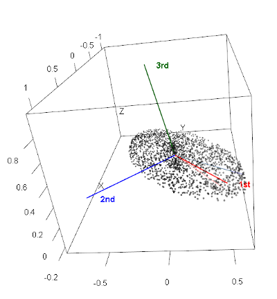

---
metadata-files:
  - ../../_templates/_lectures.yml
title: "Lecture: Principal Component Analysis"
subtitle: "Ordination by eigen-decomposition"
description: "Principal Component Analysis (PCA) in full — what prcomp() is actually solving, eigenvalues and eigenvectors, axis rotation, standardization, scree plots and component-retention rules, loadings, the arbitrary sign of a component, scores and biplots, worked step-by-step on the classic iris flower dataset."
categories: [Multivariate, PCA]
order: 19
week: 14
author: "Bill Perry"

knitr:
  opts_chunk:
    paged.print: false
    collapse: true
format:
  html:
    downloads: [docx, pptx]  # This creates download links for all three
  revealjs:
    output-ext: "slides.html"
  docx:
    reference-doc: ../../ms_templates/custom-reference-compact.docx
    fig-width: 2.5
    fig-height: 2.5
    fig-dpi: 300
    dpi: 300            # tell Pandoc the real render dpi so it sizes figures correctly
  pptx: default
execute:
  echo: true
---

```{r setup_libraries}
#| include: false
#| message: false
#| warning: false
library(vegan)
library(FactoMineR)
library(factoextra)
library(ggfortify)
library(corrplot)
library(GGally)
library(knitr)
library(patchwork)
library(janitor)
library(plotly)
library(tidyverse)

theme_set(theme_minimal(base_size = 9))

iris_df <- iris %>%
  clean_names() %>%
  mutate(ind = row_number())

# the four measurements only -- this is what PCA sees
iris_data <- iris_df %>% dplyr::select(sepal_length, sepal_width,
                                       petal_length, petal_width)

iris_long_df <- iris_df %>%
  pivot_longer(cols = -c(species, ind), names_to = "variable",
               values_to = "values")
```

## Part 1 · Where We Left Off {.divider}

## Last Week: The Multivariate Toolkit

::::: columns
::: {.column width="55%"}
### Three steps, in order

1.  **Standardize** — because units are not biology.
2.  **Choose a distance** — Euclidean for continuous traits,
    Bray–Curtis for species counts, Jaccard for presence–absence. This
    is the modelling decision.
3.  **Ordinate** — draw the resemblances on a readable 2-D map.

### Where PCA sits

-   PCA is the **eigen-decomposition** branch of that map: it works on
    a correlation or covariance matrix, implies **Euclidean** distance,
    and assumes **linear** relationships.
-   In exchange it gives you ordered axes, % variance explained, and
    **loadings** — which NMDS cannot.
:::

::: {.column width="45%"}
{width="3.40in"}

An ordination of the kind we are building toward.
:::
:::::

## Today's Question

::::: columns
::: {.column width="55%"}
### Open the box

-   Last week we ran `prcomp()` and read the answer. Today we ask
    **what it actually solved**.
-   By the end you will be able to say, precisely:
    -   what an **eigenvalue** is and why it equals a variance
    -   what an **eigenvector** is and why its entries are the loadings
    -   why there are exactly *p* components for *p* variables
    -   why component **signs** are arbitrary, and what to do about it
    -   how to decide **how many** components to keep

::: callout-note
Gotelli & Ellison, *A Primer of Ecological Statistics*, **Ch. 12** —
The Analysis of Multivariate Data — is the core reference.
:::
:::

::: {.column width="45%"}
### The core equation

For object *i* and component *k*:

$$z_{ik} = c_{k1}y_{i1} + c_{k2}y_{i2} + \cdots + c_{kp}y_{ip}$$

-   $y_{i1} \ldots y_{ip}$ — the **original** values for object *i*
-   $c_{k1} \ldots c_{kp}$ — the **loadings**: coefficients saying how
    much each original variable matters to component *k*
-   $z_{ik}$ — the **score**: object *i*'s position on component *k*
-   PCA's whole job is to **find the** $c$**'s**.
:::
:::::

## Today's Data: Iris

::::: columns
::: {.column width="48%"}
### Four measurements, three species

-   `r nrow(iris_df)` flowers, `r ncol(iris_data)` measurements (cm),
    50 from each of three species.
-   Small enough to follow every number by hand, correlated enough for
    PCA to have something to do.
-   **The test we will apply**: PCA is never told which species a flower
    belongs to. Does it recover them anyway?

```{r load_data}
#| echo: true
iris_df <- iris %>% clean_names()

iris_data <- iris_df %>%
  dplyr::select(-species)
```
:::

::: {.column width="52%"}
```{r l17-01}
#| echo: false
#| fig-width: 3.8
#| fig-height: 3.2
#| fig-alt: "Faceted boxplots of the four iris measurements (sepal length, sepal width, petal length, petal width) split by species, one panel per variable, each with a free y-axis scale."
iris_long_df %>%
  ggplot(aes(species, values, fill = species)) +
  geom_boxplot(linewidth = 0.3, outlier.size = 0.5) +
  facet_wrap(~variable, scales = "free_y") +
  labs(x = NULL, y = NULL) +
  theme_minimal(base_size = 7) +
  theme(legend.position = "none",
        axis.text.x = element_text(angle = 30, hjust = 1))
```
:::
:::::

## The Problem PCA Solves

::::: columns
::: {.column width="42%"}
### Four dimensions is already too many

-   With 4 variables there are **6** pairwise scatterplots. With 10
    there are 45. With 27 there are 351.
-   No set of 2-D plots shows you how all the variables move
    *together*.
-   **PCA's offer**: a small number of new axes, built from the old
    ones, that carry most of the information.
-   And it will do it **without being told about species**.
:::

::: {.column width="58%"}
```{r pca-01}
#| echo: false
#| message: false
#| warning: false
#| fig-width: 4.4
#| fig-height: 3.4
#| fig-alt: "Pairs plot matrix of the four iris measurements, colored by species, showing scatterplots below the diagonal, correlation coefficients above the diagonal, and density curves on the diagonal, illustrating the challenge of visualizing four correlated dimensions at once."
ggpairs(iris_df, columns = 1:4,
        aes(color = species, alpha = 0.7),
        upper = list(continuous = wrap("cor", size = 2)),
        lower = list(continuous = wrap("points", alpha = 0.6, size = 0.5)),
        diag  = list(continuous = wrap("densityDiag", alpha = 0.6))) +
  scale_color_manual(values = c(setosa = "#00AFBB", versicolor = "#E7B800",
                                virginica = "#FC4E07")) +
  scale_fill_manual(values = c(setosa = "#00AFBB", versicolor = "#E7B800",
                               virginica = "#FC4E07")) +
  theme_minimal(base_size = 6) +
  theme(strip.text = element_text(size = 6), axis.text = element_text(size = 4))
```
:::
:::::

## Part 2 · Eigenvalues, Eigenvectors, and Rotation {.divider}

## PCA Is a Rotation

::::: columns
::: {.column width="52%"}
### The 2-variable picture

-   Start with two correlated variables — crab burrows and crab
    biomass. The cloud of points runs diagonally.
-   The original axes are a **bad description**: both of them carry some
    of the same information.
-   PCA keeps the points exactly where they are and **turns the axes**
    until the first one lies along the direction of greatest spread.
-   Nothing is lost in a rotation. The distances between points are
    identical before and after.
:::

::: {.column width="48%"}
{width="3.30in"}
:::
:::::

## The Same Data, New Axes

::::: columns
::: {.column width="48%"}
{width="3.30in"}
:::

::: {.column width="52%"}
### After the rotation

-   PC1 is now horizontal and carries most of the spread; PC2 is
    vertical and carries what is left.
-   The two new axes are **orthogonal**, which is the geometric way of
    saying the two components are **uncorrelated**.
-   The old variables are still in there — they are now the diagonal
    reference lines, and the angle each one makes with PC1 is exactly
    what its **loading** records.
-   **The rotation is chosen to maximize the variance on PC1.** That one
    sentence is the whole of PCA.
:::
:::::

## Beyond Two Dimensions

::::: columns
::: {.column width="52%"}
### Same idea, more axes

-   In 3-D the rotation finds a first axis through the long direction of
    the cloud, a second at right angles to it through the longest
    remaining direction, and a third fixed by the first two.
-   With *p* variables you get **exactly *p* components** — the rotation
    uses up every dimension.
-   You do not do this by eye. The components are **extracted from the
    *p* × *p* covariance or correlation matrix** of the original
    variables, and the extraction is an eigen-decomposition.
:::

::: {.column width="48%"}
{width="3.30in"}
:::
:::::

## Eigenvalues and Eigenvectors

::::: columns
::: {.column width="50%"}
### Eigenvalue ($\lambda$)

-   **How much variance** the component captures, in the units of the
    input matrix.
-   Run PCA on a **correlation** matrix and each original variable
    contributes exactly 1 unit of variance, so:
    -   the eigenvalues sum to ***p***
    -   an eigenvalue of 1 means "this component is worth one average
        variable"
-   % variance for component *k*:
    $\lambda_k / \sum_{j=1}^{p}\lambda_j$
:::

::: {.column width="50%"}
### Eigenvector (**c**)

-   The **list of coefficients** — one per original variable — that
    builds the component. There are *p* entries in each eigenvector and
    *p* eigenvectors.
-   Each eigenvector has **length 1**: the loadings' squares sum to 1.
-   Eigenvectors are **orthogonal** to one another: any two of them have
    a dot product of 0. That is why the components are uncorrelated.
-   Each component has one eigenvalue and one eigenvector: *how big*,
    and *which way*.
:::
:::::

## Correlation Matrix or Covariance Matrix?

::::: columns
::: {.column width="52%"}
### The choice *is* the standardization choice

-   **Covariance matrix** → variables keep their original variances, so
    a variable measured in big numbers dominates.
    -   Use it when all variables are in the **same units** and the
        differences in spread are real biology.
-   **Correlation matrix** → every variable is rescaled to variance 1
    before decomposition, so every variable gets an **equal vote**.
    -   Use it when the units differ — almost always, in ecology.
-   `prcomp(x, scale. = TRUE)` *is* "use the correlation matrix".
:::

::: {.column width="48%"}
### Why correlation matters so much

-   PCA earns its keep by **collapsing redundancy**. If the original
    variables are uncorrelated, there is no redundancy to collapse:
    -   every eigenvalue comes out near 1
    -   the "components" are just the original variables, reordered
    -   nothing has been reduced
-   **Correlated variables → fewer components carry more variance.**
    Check the correlation matrix *before* you run anything.
:::
:::::

## Part 3 · Assumptions and Standardization {.divider}

## What PCA Assumes

::::: columns
::: {.column width="50%"}
### Check these first

1.  **Linear relationships** between variables — PCA sees only straight
    lines.
2.  **No extreme outliers** — one wild object can define a whole
    component.
3.  **Variables are correlated** — otherwise there is nothing to
    collapse.
4.  **Adequate sample size** — at least 3× as many objects as
    variables; *n* > 50 is comfortable. We have
    `r nrow(iris_df)` flowers and `r ncol(iris_data)` variables.
5.  **Complete cases** — `prcomp()` will not handle missing values for
    you.
:::

::: {.column width="50%"}
### Are the iris variables correlated?

```{r check_correlations}
#| echo: false
#| fig-width: 3.4
#| fig-height: 2.9
#| fig-alt: "Correlation matrix heatmap of the four iris variables, with color and printed coefficients showing the strength and direction of each pairwise correlation, used to check whether variables are correlated enough for PCA to be useful."
corrplot(cor(iris_data), method = "color", type = "upper",
         addCoef.col = "grey25", tl.cex = 0.7, number.cex = 0.8,
         mar = c(0, 0, 0, 0))
```

-   Petal length and petal width correlate at
    **`r round(cor(iris_data$petal_length, iris_data$petal_width), 2)`**.
    Plenty of redundancy to collapse.
:::
:::::

## Checking Linearity and Outliers

::::: columns
::: {.column width="50%"}
```{r check_linearity}
#| echo: false
#| message: false
#| warning: false
#| fig-width: 3.6
#| fig-height: 3.0
#| fig-alt: "Pairs plot matrix of the four iris variables with correlation coefficients above the diagonal and smoothed scatterplots below the diagonal, used to check that relationships between variables are approximately linear."
ggpairs(iris_data,
        upper = list(continuous = wrap("cor", size = 2.5)),
        lower = list(continuous = wrap("smooth", size = 0.4))) +
  theme_minimal(base_size = 6)
```

Relationships are close to straight lines — the setosa cluster makes
some panels look bent, but within species they are linear.
:::

::: {.column width="50%"}
```{r check_outliers}
#| echo: false
#| fig-width: 3.4
#| fig-height: 2.8
#| fig-alt: "Boxplots of each of the four iris variables side by side, used to visually check for extreme outlier values before running PCA."
iris_data %>%
  pivot_longer(everything(), names_to = "variable", values_to = "value") %>%
  ggplot(aes(x = variable, y = value)) +
  geom_boxplot(linewidth = 0.3, outlier.size = 0.6) +
  labs(x = NULL, y = "Value (cm)") +
  theme_minimal(base_size = 7) +
  theme(axis.text.x = element_text(angle = 30, hjust = 1))
```

A handful of mild sepal-width outliers, nothing extreme. Note how much
wider **petal length** spreads than **sepal width** — that is the
standardization problem in one picture.
:::
:::::

## Standardization

::::: columns
::: {.column width="52%"}
### Why it is needed here

```{r sds}
#| echo: false
round(apply(iris_data, 2, sd), 3)
```

-   Petal length varies about **4×** as much as sepal width does.
    On a covariance matrix it would dominate PC1 for no better reason
    than that.
-   **Z-score**: $Z = (Y_i - \bar{Y})/s$, giving mean 0 and SD 1.
-   A sepal length of 5.1 cm becomes
    **`r round((5.1 - mean(iris_data$sepal_length)) / sd(iris_data$sepal_length), 2)`**
    — just under one SD below average.
:::

::: {.column width="48%"}
```{r standardize_data}
#| echo: true
iris_scaled <- scale(iris_data)

# check it worked
round(colMeans(iris_scaled), 3)
round(apply(iris_scaled, 2, sd), 3)
```

::: callout-note
`scale()` here, then `prcomp(..., scale. = FALSE)`, is exactly
equivalent to handing the raw data to `prcomp(..., scale. = TRUE)`.
We do it in two steps so the standardized values are visible.
:::
:::
:::::

## Part 4 · Running PCA and Reading the Output {.divider}

## Running the Analysis

::::: columns
::: {.column width="48%"}
### The call

```{r perform_pca}
#| echo: true
iris_pca <- prcomp(iris_scaled,
                   center = FALSE,
                   scale. = FALSE)
```

-   `center = FALSE`, `scale. = FALSE` because `scale()` already did
    both. Doing it twice is harmless but confusing.
-   `vegan::rda(iris_scaled)` gives the identical decomposition under a
    different name — PCA is PCA.
:::

::: {.column width="52%"}
### What is inside the result

::: {.compact-table}
| Element | What it holds |
|----|----|
| `sdev` | $\sqrt{\lambda}$ — SD of each component |
| `rotation` | the **eigenvectors**: loadings, variables × components |
| `x` | the **scores**: objects × components |
| `center`, `scale` | what was subtracted and divided |
:::

-   `sdev^2` gives the eigenvalues. Everything else in this lecture is
    read off `rotation` and `x`.
:::
:::::

## The Summary Table

```{r pca_summary}
#| echo: true
summary(iris_pca)
```

```{r eig_objects}
#| include: false
eigenvalues     <- iris_pca$sdev^2
prop_variance   <- eigenvalues / sum(eigenvalues)
cumsum_variance <- cumsum(prop_variance)
```

-   **Standard deviation** is $\sqrt{\lambda}$, not the eigenvalue
    itself — square it to get the variance.
-   PC1 explains **`r round(prop_variance[1] * 100, 1)`%**, PC2
    **`r round(prop_variance[2] * 100, 1)`%**; together
    **`r round(cumsum_variance[2] * 100, 1)`%** of all the variation in
    four variables.
-   The four eigenvalues sum to **`r round(sum(eigenvalues), 1)`** —
    one unit per standardized variable, as promised.

## Eigenvalues in a Table

::::: columns
::: {.column width="52%"}
```{r pca_eigenvalues}
#| echo: true
tibble(
  Component  = paste0("PC", 1:4),
  Eigenvalue = round(eigenvalues, 3),
  Percent    = round(prop_variance * 100, 2),
  Cumulative = round(cumsum_variance * 100, 2))
```
:::

::: {.column width="48%"}
### Reading it

-   PC1's eigenvalue is
    **`r round(eigenvalues[1], 2)`**: it is worth about
    `r round(eigenvalues[1], 1)` of the original variables all by
    itself.
-   PC3 and PC4 together carry
    **`r round(sum(prop_variance[3:4]) * 100, 1)`%** — essentially
    measurement noise.
-   We have reduced 4 variables to 2 numbers and kept
    **`r round(cumsum_variance[2] * 100, 1)`%** of the information. That
    is dimension reduction working.
:::
:::::

## Part 5 · How Many Components Do You Keep? {.divider}

## The Scree Plot

::::: columns
::: {.column width="52%"}
### What it is

-   "Scree" is the geological term for the loose rubble at the base of a
    cliff. The plot usually shows a **cliff** then **rubble**.
-   **Y-axis**: % variance explained. **X-axis**: component number.
-   **The elbow method**: find where the line stops dropping steeply and
    flattens out. Keep the components *before* the flattening.
-   Here the cliff runs PC1 → PC2 and the rubble starts at PC3. The
    elbow says **keep two**.
:::

::: {.column width="48%"}
```{r scree_plot}
#| echo: false
#| fig-width: 3.6
#| fig-height: 3.0
#| fig-alt: "Scree plot of percent variance explained by each of the four principal components, with labeled bars, showing a steep drop after PC1 and PC2 and an 'elbow' suggesting the first two components capture most of the variation."
fviz_eig(iris_pca, addlabels = TRUE, ylim = c(0, 85),
         barfill = "darkblue", barcolor = "darkblue", alpha = 0.7) +
  labs(title = NULL, x = "Principal component",
       y = "% of variance explained") +
  theme_minimal(base_size = 8)
```
:::
:::::

## Three Rules, and What To Do When They Disagree

::::: columns
::: {.column width="48%"}
```{r eigenvalue_rule}
#| echo: true
# Kaiser criterion: eigenvalue > 1
sum(eigenvalues > 1)

# first PC reaching 80% cumulative
which(cumsum_variance >= 0.80)[1]
```

-   **Kaiser** ($\lambda > 1$) says keep **1**.
-   **80% cumulative** says keep **2**.
-   **The elbow** says keep **2**.
:::

::: {.column width="52%"}
### Resolving it

-   The rules are **guidelines, not tests**, and they routinely
    disagree. Kaiser is known to be strict with few variables — with
    only 4 variables a second component has to be very strong to clear
    an eigenvalue of 1, and PC2's is
    **`r round(eigenvalues[2], 2)`**.
-   **Two more criteria settle it in practice:**
    1.  Does the component have an **interpretable** biological
        meaning? PC2 does — see Part 6.
    2.  Does keeping it change what you can **see**? It does: PC2 is
        what separates the species that PC1 alone confuses.
-   **We keep two.** Say which rule you used and why.
:::
:::::

## Part 6 · Loadings and Interpretation {.divider}

## What Loadings Are

::::: columns
::: {.column width="50%"}
### Recipes for the components

-   A loading is one coefficient $c_{kj}$ — how much original variable
    *j* goes into component *k*.
-   **Values run from −1 to +1**, like correlations.
-   **|loading| > 0.5** → dominates the component.
    **|loading| ≈ 0** → irrelevant to it.
-   **Signs within a component** are what carry the meaning:
    -   all the same sign → a **size** axis, everything moving together
    -   mixed signs → a **shape** axis, a trade-off
:::

::: {.column width="50%"}
```{r component_loadings}
#| echo: true
round(iris_pca$rotation, 3)
```

-   Each column is one **eigenvector**. Square a column and the entries
    sum to 1.
:::
:::::

## Eigenvector Properties, Checked

::::: columns
::: {.column width="50%"}
### The three claims from Part 2

```{r eigen_props}
#| echo: true
# 1. unit length
round(colSums(iris_pca$rotation^2), 3)

# 2. orthogonal: PC1 . PC2 = 0
round(sum(iris_pca$rotation[, 1] *
          iris_pca$rotation[, 2]), 10)

# 3. scores are uncorrelated
round(cor(iris_pca$x[, 1],
          iris_pca$x[, 2]), 10)
```
:::

::: {.column width="50%"}
### Why this matters practically

-   **Unit length** is why loadings can be compared across variables
    within a component — they are competing for a fixed budget of 1.
-   **Orthogonality** is why you can drop PC scores straight into an
    ANOVA or a regression with **no multicollinearity**. That is one of
    PCA's most useful side effects.
-   It is also why PC2 can only describe what PC1 left behind: it is
    constrained to be at right angles to it.
:::
:::::

## ⚠️ The Sign of a Component Is Arbitrary

::::: columns
::: {.column width="55%"}
### Expect this, do not fight it

-   An eigenvector defines a **line**, and a line has no preferred end.
    Multiply a component's loadings **and** its scores by −1 and you
    have an equally valid answer:
    -   same eigenvalue, same % variance
    -   same distances between points
    -   same biology
-   Different software, different R versions, or dropping one flower can
    all flip a sign. **Nothing is wrong when that happens.**
-   The real error is to flip the loadings and not the scores, or to
    write "higher PC1" without saying what higher *means*.
:::

::: {.column width="45%"}
```{r sign_demo}
#| echo: true
# flip PC2 entirely
flip_load <- -iris_pca$rotation[, 2]
flip_score <- -iris_pca$x[, 2]

round(c(
  var_original = var(iris_pca$x[, 2]),
  var_flipped  = var(flip_score)), 4)
```

**The rule**: before you write a sentence about a component, translate
the sign into biology. Say "*larger flowers*", not "*higher PC1*".
:::
:::::

## PC1: Overall Flower Size

::::: columns
::: {.column width="50%"}
```{r pc1_table}
#| echo: false
round(iris_pca$rotation[, 1], 3)
```

### The pattern

-   Three variables load together and strongly:
    sepal length **`r round(iris_pca$rotation["sepal_length", 1], 2)`**,
    petal length **`r round(iris_pca$rotation["petal_length", 1], 2)`**,
    petal width **`r round(iris_pca$rotation["petal_width", 1], 2)`**.
-   Sepal width opposes them at
    **`r round(iris_pca$rotation["sepal_width", 1], 2)`** — moderate,
    and in the other direction.
:::

::: {.column width="50%"}
### The interpretation

-   **PC1 is an overall size axis, with a twist.** On this run a high
    PC1 score means a flower with **long sepals, long petals and wide
    petals, but relatively narrow sepals**.
-   That is not a bookkeeping quirk — it is real iris biology. The big
    *virginica* flowers are big in every dimension *except* that their
    sepals are proportionally narrower than setosa's.
-   So PC1 is better described as **"large, elongated flowers vs. small,
    broad-sepalled flowers"** than as pure size.
-   It carries **`r round(prop_variance[1] * 100, 1)`%** of all the
    variation.
:::
:::::

## PC2: Sepal Width

::::: columns
::: {.column width="50%"}
```{r pc2_table}
#| echo: false
round(iris_pca$rotation[, 2], 3)
```

### The pattern

-   **Sepal width dominates completely** at
    **`r round(iris_pca$rotation["sepal_width", 2], 2)`**.
-   Sepal length contributes moderately
    (**`r round(iris_pca$rotation["sepal_length", 2], 2)`**).
-   The two petal measurements are **effectively absent**
    (`r round(iris_pca$rotation["petal_length", 2], 3)` and
    `r round(iris_pca$rotation["petal_width", 2], 3)`).
:::

::: {.column width="50%"}
### The interpretation

-   PC2 is **not** a general shape contrast — it is very nearly
    "sepal width, by itself", plus a little sepal length.
-   Because the loading is **negative**, on this run:
    -   **low PC2 → wide sepals**
    -   **high PC2 → narrow sepals**
-   This is PC1's leftovers: sepal width was the one variable PC1 could
    not account for, so PC2 is built almost entirely out of it.
-   **`r round(prop_variance[2] * 100, 1)`%** of the variation — the
    sepal-width story is a real and separate axis of iris variation.
:::
:::::

## The Loading Plot

::::: columns
::: {.column width="50%"}
```{r loading_visualization}
#| echo: false
#| fig-width: 3.6
#| fig-height: 3.2
#| fig-alt: "Variable loadings plot showing each of the four iris measurements as an arrow on the PC1-PC2 plane, arrow direction and length indicating how strongly each variable contributes to each component, colored by contribution magnitude."
fviz_pca_var(iris_pca, col.var = "contrib",
             gradient.cols = c("#00AFBB", "#E7B800", "#FC4E07"),
             repel = TRUE, labelsize = 3) +
  labs(title = NULL) +
  theme_minimal(base_size = 8)
```
:::

::: {.column width="50%"}
### Reading the arrows

-   **Direction** = which components the variable builds.
    **Length** = how well this plane represents it. The circle is the
    maximum possible.
-   **Petal length, petal width and sepal length point right** —
    they build positive PC1 together, and their small mutual angles say
    they are strongly correlated.
-   **Sepal width points down and slightly left** — nearly at right
    angles to the petals, which is the plot's way of saying it carries
    almost independent information.
-   That near-90° angle is why sepal width got its own component.
:::
:::::

## Part 7 · Scores, Biplots, and Species {.divider}

## Scores: Where Each Flower Lands

::::: columns
::: {.column width="48%"}
### From loadings to positions

-   A **score** is an object's coordinate on a component — the result of
    the recipe, applied to that object's standardized values.
-   `iris_pca$x` holds them, 150 rows × 4 components.

```{r scores_head}
#| echo: false
as_tibble(iris_pca$x) %>%
  mutate(species = iris_df$species, .before = 1) %>%
  slice(c(1:3, 51:53, 101:103)) %>%
  mutate(across(PC1:PC4, \(z) round(z, 2)))
```
:::

::: {.column width="52%"}
```{r pca_scores_plot}
#| echo: false
#| fig-width: 3.8
#| fig-height: 3.2
#| fig-alt: "Scatterplot of iris flowers' PC1 and PC2 scores, colored by species with 68% confidence ellipses, showing the three species forming largely separate clusters."
as_tibble(iris_pca$x) %>%
  mutate(species = iris_df$species) %>%
  ggplot(aes(PC1, PC2, color = species)) +
  geom_point(size = 1.6, alpha = 0.8) +
  stat_ellipse(level = 0.68, linetype = 2, linewidth = 0.4) +
  scale_color_manual(values = c("#00AFBB", "#E7B800", "#FC4E07")) +
  labs(x = paste0("PC1 (", round(prop_variance[1] * 100, 1), "%)"),
       y = paste0("PC2 (", round(prop_variance[2] * 100, 1), "%)"),
       color = NULL) +
  theme_minimal(base_size = 8) +
  theme(legend.position = "bottom")
```
:::
:::::

## The Biplot

::::: columns
::: {.column width="48%"}
```{r pca_biplot_species}
#| echo: false
#| warning: false
#| fig-width: 3.8
#| fig-height: 3.4
#| fig-alt: "PCA biplot of iris flowers on PC1 and PC2, points colored by species with confidence ellipses, and arrows showing the original variable loadings. Setosa separates on the left, virginica on the right, and versicolor is intermediate, showing PCA cleanly separating the three species."
fviz_pca_biplot(iris_pca, geom.ind = "point",
                col.ind = iris_df$species,
                palette = c("#00AFBB", "#E7B800", "#FC4E07"),
                addEllipses = TRUE, label = "var",
                col.var = "black", repel = TRUE, labelsize = 2.5,
                title = NULL) +
  theme_minimal(base_size = 7) +
  theme(legend.position = "bottom")
```
:::

::: {.column width="52%"}
### Points and arrows together

-   **Points** = flowers (scores). **Arrows** = variables (loadings),
    on the same plane.
-   A flower lying out along an arrow is **high** in that variable.
-   **Setosa sits far left** — low PC1, so short petals and sepals, but
    (per PC1's negative sepal-width loading) **broad** sepals.
-   **Virginica sits right** — long petals and sepals, narrower sepals.
-   **Versicolor sits between**, overlapping virginica slightly.
-   **PCA was never told about species.** It recovered them from
    morphology alone.
:::
:::::

## Did PCA Recover the Species?

::::: columns
::: {.column width="50%"}
```{r species_means}
#| echo: true
as_tibble(iris_pca$x) %>%
  mutate(species = iris_df$species) %>%
  group_by(species) %>%
  summarise(across(PC1:PC2,
                   \(z) round(mean(z), 2)))
```
:::

::: {.column width="50%"}
### Reading it, sign resolved

-   **PC1 orders the species cleanly**: setosa → versicolor →
    virginica, smallest and broadest-sepalled to largest and
    narrowest-sepalled.
-   **PC2 does something different**: versicolor stands apart from
    *both* others. Setosa and virginica have similar PC2 scores despite
    sitting at opposite ends of PC1.
-   That is exactly the job of a second component — it describes what
    the first one could not. Dropping PC2 on Kaiser's advice would have
    thrown away a real signal.
:::
:::::

## Part 8 · Other Tools, Reporting, and Wrap-Up {.divider}

## The Same PCA, Three Other Packages {.tight-code}

::: {.panel-tabset}

### FactoMineR

```{r facto}
#| echo: true
#| fig-width: 5
#| fig-height: 2.7
#| fig-alt: "PCA biplot produced by FactoMineR and factoextra, with iris flowers colored by species, 95% confidence ellipses around each species, and variable loading arrows overlaid."
pca_facto <- PCA(iris_data, graph = FALSE, scale.unit = TRUE)

fviz_pca_biplot(pca_facto, col.ind = iris_df$species,
                palette = "jco", addEllipses = TRUE,
                ellipse.level = 0.95, repel = TRUE,
                geom.ind = "point", labelsize = 3, title = NULL) +
  theme_minimal(base_size = 8)
```

### ggfortify

```{r ggfort}
#| echo: true
#| fig-width: 5
#| fig-height: 2.7
#| fig-alt: "Quick PCA plot built with ggfortify's autoplot(): iris flowers plotted on PC1 and PC2, colored by species, with variable loading arrows and labels overlaid and normal-distribution frames around each species."
autoplot(iris_pca, data = iris_df, colour = "species",
         loadings = TRUE, loadings.label = TRUE,
         frame = TRUE, frame.type = "norm") +
  theme_minimal(base_size = 8)
```

### vegan

```{r vegan_rda}
#| echo: true
#| fig-width: 5
#| fig-height: 2.7
#| fig-alt: "Base-R vegan biplot of the iris PCA produced by rda(), showing sample points and variable arrows on the first two principal axes."
iris_rda <- rda(iris_scaled)

biplot(iris_rda, scaling = 2)
```

:::

-   All four routes decompose the same matrix. **The numbers are
    identical**; only the plotting defaults and the sign conventions
    differ.

## Reporting a PCA

::::: columns
::: {.column width="52%"}
### Methods

> "The four floral measurements were standardized to zero mean and unit
> variance and subjected to principal component analysis on the
> correlation matrix (`prcomp()`, R `r getRversion()`). Two components
> were retained on the basis of the scree plot and cumulative variance
> (> 80%)."

### Results

> "PC1 and PC2 together explained
> `r round(cumsum_variance[2] * 100, 1)`% of the variation
> (PC1 `r round(prop_variance[1] * 100, 1)`%,
> PC2 `r round(prop_variance[2] * 100, 1)`%). PC1 loaded positively on
> petal length (0.58), petal width (0.57) and sepal length (0.52), and
> negatively on sepal width (−0.27)..."
:::

::: {.column width="48%"}
### Always include

1.  Whether you used the **correlation** or **covariance** matrix
2.  **% variance** for every component you interpret
3.  The **loadings** for retained components
4.  How you decided **how many** to keep
5.  The **biological reading** of each axis, with the sign resolved

### Never include

-   All *p* components when 2 are meaningful
-   Loadings below |0.3|
-   Raw eigenvalues instead of percentages
-   Every individual score
:::
:::::

## When PCA Is and Is Not the Tool

::::: columns
::: {.column width="50%"}
### Use PCA when

-   Variables are **continuous and correlated**
-   Relationships are **linear**
-   Few zeros, and Euclidean distance is sensible
-   The goal is **dimension reduction** or **exploration**
-   You want **uncorrelated** variables for a downstream model
:::

::: {.column width="50%"}
### Use something else when

-   **Species composition with many zeros** → NMDS or PCoA on
    Bray–Curtis *(week 15)*
-   **Categorical variables** → CA or MCA
-   **You already have a dissimilarity matrix** → PCoA or NMDS
-   **You want to classify or predict** → discriminant analysis
-   **You want to test groups** → PERMANOVA *(week 15)*
:::
:::::

## Summary

::::: columns
::: {.column width="50%"}
### What PCA did

-   Rotated 4 correlated axes into 4 uncorrelated ones, ordered by
    variance.
-   **PC1 (`r round(prop_variance[1] * 100, 1)`%)** — large elongated
    flowers vs. small broad-sepalled ones.
-   **PC2 (`r round(prop_variance[2] * 100, 1)`%)** — sepal width,
    almost by itself.
-   Together **`r round(cumsum_variance[2] * 100, 1)`%** of the
    variation in **2** numbers instead of 4.
-   And it separated three species it was never told about.
:::

::: {.column width="50%"}
### What to carry forward

-   **Eigenvalue = variance; eigenvector = loadings.** On a correlation
    matrix the eigenvalues sum to *p*.
-   **Standardize** unless the units are identical and the spreads are
    biology.
-   **Component signs are arbitrary** — translate to biology before
    writing.
-   Retention rules **disagree**; interpretability breaks the tie.
-   **Next week**: when the data are counts and Euclidean distance
    fails — NMDS, cluster analysis, PERMANOVA and ANOSIM.
:::
:::::

## Readings

-   **Gotelli & Ellison**, *A Primer of Ecological Statistics*,
    **Ch. 12** — The Analysis of Multivariate Data
-   **Quinn & Keough**, *Experimental Design and Data Analysis for
    Biologists*, **Ch. 17** — Principal components and correspondence
    analysis
-   Whitlock & Schluter does not cover ordination.

### Data source

-   **Iris**: Anderson, E. (1935), *The irises of the Gaspé Peninsula*;
    made famous by Fisher, R.A. (1936), *Annals of Eugenics* 7:179–188.
    Shipped with base R as `iris`.
