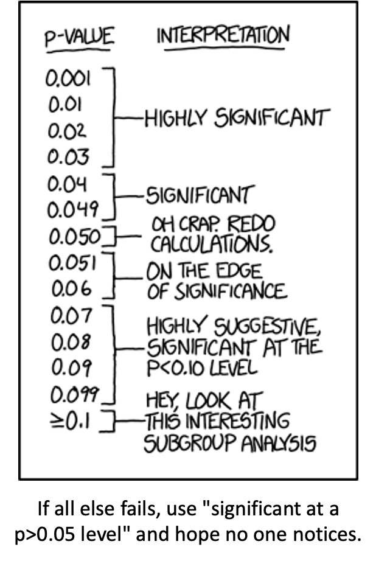
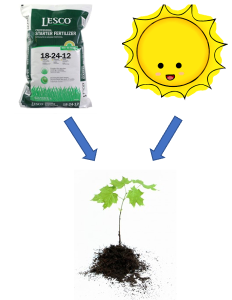
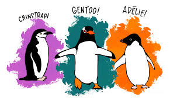
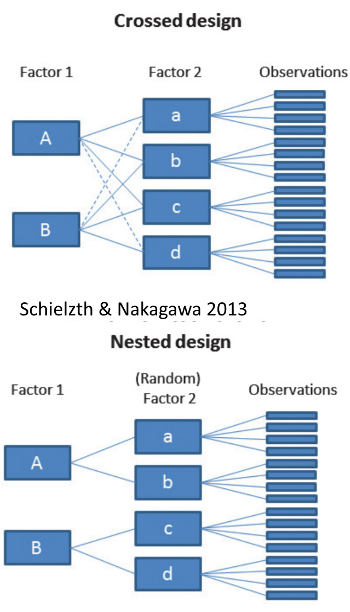
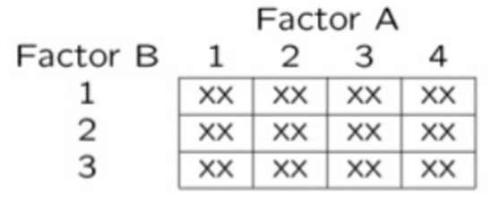
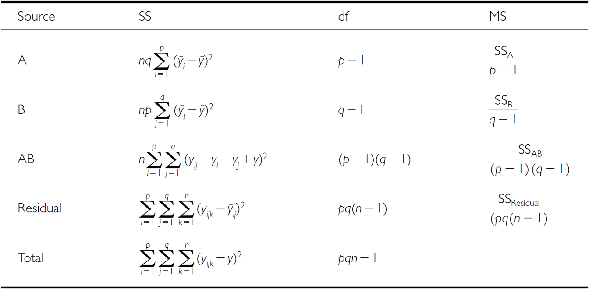
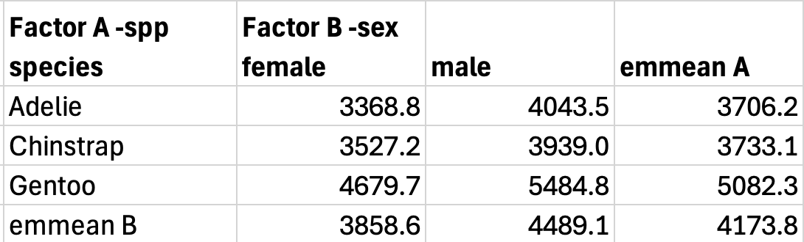
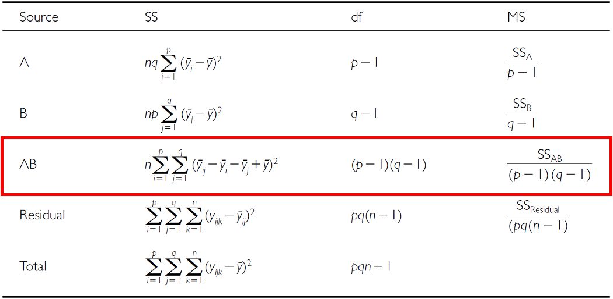
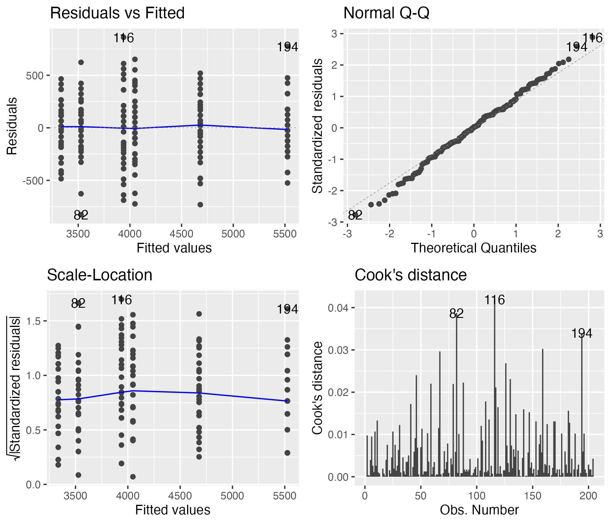

---
metadata-files:
  - ../../_templates/_lectures.yml
title: "Lecture: Two-Way ANOVA"
subtitle: "Factorial designs"
description: "Factorial (two-factor) ANOVA, main effects and interactions, estimated marginal means, Type I/II/III sums of squares, and balanced vs. unbalanced designs — on the palmerpenguins species-by-sex dataset."
categories: [ANOVA]
order: 13
week: 9
author: "Bill Perry"

knitr:
  opts_chunk:
    paged.print: true
    collapse: true

format:
  html:
    downloads: [docx, pptx]  # This creates download links for all three
  revealjs:
    output-ext: "slides.html"
  docx:
    reference-doc: ../../ms_templates/custom-reference-compact.docx
    fig-width: 2.5
    fig-height: 2.5
    fig-dpi: 300
    dpi: 300            # tell Pandoc the real render dpi so it sizes figures correctly
  pptx: default
execute:
  echo: true
---

```{r two-way-anova-01}
#| echo: false
#| message: false
#| warning: false
library(palmerpenguins)
library(emmeans)
library(ggfortify)
library(car)
library(broom)
library(patchwork)
library(tidyverse)

p_df <- penguins %>%
  filter(!is.na(body_mass_g),
         !is.na(sex),
         !is.na(species)) %>%
  select(species, sex, body_mass_g)
```

## Where We Left Off

::::::: columns
:::: {.column width="60%"}
Covered last time — one-way ANOVA:

- The ANOVA model, and fixed vs. random predictors
- Partitioning variance: $SS_{total} = SS_{groups} + SS_{residual}$
- The null hypothesis, and the F-ratio that tests it
- Assumptions and diagnostics on the residuals
- Post-hoc tests — Tukey and others
- Reporting the result

::: callout-note
**✅ Key idea from last lecture**

One-way ANOVA asks "do these groups differ?" for one factor. Today: what happens when two factors act *together* — separately, and possibly interacting?
:::
::::

:::: {.column width="40%"}
{width="3.12in" fig-alt="XKCD comic listing p-value ranges with increasingly tongue-in-cheek interpretations, from 'Highly Significant' at p under 0.03 down through 'On the edge of significance' and 'Hey, look at this interesting subgroup analysis' at p >= 0.1, captioned 'If all else fails, use significant at a p>0.05 level and hope no one notices' — a joke about p-hacking and misusing significance thresholds."}
::::
:::::::

## Part 1 · Factorial ANOVA — the Concept {.divider}

## Two-Factor Designs (2-Way ANOVA)

::::::: columns
:::: {.column width="60%"}
- Very common in ecology
- Can have more factors (e.g., 3-way ANOVA), but interpretation gets very challenging
- Most multifactor designs are factorial or nested
- We'll cover a 2-factor ANOVA — say fertilizer and sunlight, for plant biomass:
  - each can have an effect independently
  - or they may **interact**: under high light, high fertilizer grows better than either effect alone would predict

::: callout-note
**📖 Reference**

Gotelli & Ellison, *A Primer of Ecological Statistics*, Ch. 10 — The Analysis of Variance, extends to factorial designs like the one covered today.
:::
::::

:::: {.column width="40%"}
{width="2.29in" fig-alt="Diagram of a fertilizer bag and a smiling sun icon, each with an arrow pointing down to a small green seedling, illustrating fertilizer and sunlight as two separate factors that can each affect plant biomass."}

{width="2.29in" fig-alt="The palmerpenguins R package hex-sticker logo, showing simple cartoon illustrations of the three penguin species (Adelie, Chinstrap, Gentoo) used in this lecture's dataset."}
::::
:::::::

## Factorial ANOVA: Design Structure

::::::: columns
:::: {.column width="60%"}
Consider two factors:

- **Factorial/crossed:** every level of B in every level of A

{width="2.92in" fig-alt="Cartoon illustration of the three penguin species used in this lecture's dataset, each labeled: Chinstrap, Gentoo, and Adelie."}
::::

:::: {.column width="40%"}
{width="2.92in" fig-alt="Diagram contrasting a crossed design, where both levels of Factor 1 (A, B) connect to every level of Factor 2 (a, b, c, d), against a nested design below it, where each level of Factor 1 connects only to its own subset of (random) Factor 2 levels, both feeding into individual observations (Schielzth & Nakagawa 2013)."}
::::
:::::::

## Factorial ANOVA: Effect Types

::::::: columns
:::: {.column width="60%"}
In factorial designs, we look at two types of factor effects:

- **Main effect of each factor** (pooling across the other factor)
- **Interaction effects** — is there a synergistic/antagonistic effect between factors?
::::

:::: {.column width="40%"}
{width="3.12in" fig-alt="Simple grid diagram of a factorial design with Factor A across the columns (levels 1-4) and Factor B down the rows (levels 1-3), with an 'XX' marking every cell, showing every combination of the two factors is represented."}
::::
:::::::

## Part 2 · Setting Up — the Penguin Data {.divider}

## Introduction to Two-Way ANOVA

::::::: columns
:::: {.column width="60%"}
Two-way ANOVA examines:

- Main effect of Factor A (Species)
- Main effect of Factor B (Sex)
- Interaction between A × B
- **Balanced design:** equal sample sizes in all cells
- **Type III sums of squares**, which test each term adjusted for every other term — if the design is balanced, the choice of SS type doesn't matter
::::

:::: {.column width="40%"}
```{r two-way-anova-02}
#| echo: false
#| message: false
#| warning: false
#| paged-print: false
summaryu_df <- p_df %>%
  group_by(species, sex) %>%
  summarise(
    n = sum(!is.na(body_mass_g)),
    mean_mass = mean(body_mass_g),
    sd_mass = sd(body_mass_g),
    se_mass = sd_mass/sqrt(n),
    .groups = 'drop'
  ) %>%
  arrange(species, sex)
print(summaryu_df)
```
::::
:::::::

## Data Preparation — Creating a Balanced Design

::::::: columns
:::: {.column width="60%"}
The penguin data frame is unbalanced — there are unequal samples per cell.

```{r two-way-anova-03}
#| echo: false
#| message: false
#| warning: false
#| paged-print: false
original_n <- p_df %>%
  count(species, sex) %>%
  arrange(species, sex)

p_df %>%
  count(species, sex) %>%
  pivot_wider(names_from = sex,
              values_from = n,
              values_fill = 0)
```
::::

:::: {.column width="40%"}
```{r two-way-anova-04}
#| echo: false
#| message: false
#| warning: false
#| paged-print: false
#| collapse: true
min_n <- min(original_n$n)
cat(paste("Minimum n =", min_n, "\n\n"))

set.seed(123)
balanced_df <- p_df %>%
  group_by(species, sex) %>%
  sample_n(min_n) %>%
  ungroup()

balanced_n <- balanced_df %>%
  count(species, sex) %>%
  pivot_wider(names_from = sex,
              values_from = n,
              values_fill = 0)
balanced_n
```

**Statistical model:**

$$Y_{ijk} = \mu + \alpha_i + \beta_j + (\alpha\beta)_{ij} + \varepsilon_{ijk}$$

μ = grand mean, α_i = effect of species i, β_j = effect of sex j, (αβ)_ij = interaction effect, ε_ijk = random error.
::::
:::::::

## Descriptive Statistics

::::::: columns
:::: {.column width="60%"}
```{r two-way-anova-05}
#| echo: false
#| message: false
#| warning: false
#| paged-print: false
summary_df <- balanced_df %>%
  group_by(species, sex) %>%
  summarise(
    n = sum(!is.na(body_mass_g)),
    mean_mass = mean(body_mass_g),
    sd_mass = sd(body_mass_g),
    se_mass = sd_mass/sqrt(n),
    .groups = 'drop'
  ) %>%
  arrange(species, sex)
print(summary_df)
```
::::

:::: {.column width="40%"}
```{r two-way-anova-06}
#| echo: false
#| fig-width: 3.4
#| fig-height: 3
#| fig-alt: "Boxplot of penguin body mass in grams by species, with boxes filled by sex, showing mass differences across the species-by-sex combinations in the balanced dataset."
p_box_plot <- balanced_df %>%
  ggplot(aes(species, body_mass_g, fill = sex)) +
  geom_boxplot() +
  theme_minimal(base_size = 9)
p_box_plot
```
::::
:::::::

## Part 3 · The Factorial Model {.divider}

## Factorial ANOVA Models

::::::: columns
:::: {.column width="60%"}
Factorial designs can be of 3 types:

- **Model 1** — 2 fixed factors (the focus for today)
- **Model 2** — 2 random factors
- **Model 3** — 1 fixed, 1 random (mixed model) — often nested

**Model 1 ANOVA:**

$$y_{ijk} = \mu + \alpha_i + \beta_j + (\alpha\beta)_{ij} + \varepsilon_{ijk}$$
::::

:::: {.column width="40%"}
::: callout-tip
**🖐 Notice**

The formula looks identical to Model 2 and Model 3 — what changes between them is whether α, β are treated as *fixed* effects (specific groups you care about) or *random* effects (a sample from a larger population of possible groups).
:::
::::
:::::::

## Model Components — the Main Effects

::::::: columns
:::: {.column width="60%"}
$$y_{ijk} = \mu + \alpha_i + \beta_j + (\alpha\beta)_{ij} + \varepsilon_{ijk}$$

- $y_{ijk}$: value of the k-th observation from the j-th and i-th combination of B and A (sex j of species i)
- μ: overall mean (overall mass)
- $\alpha_i$: effect of the i-th level of A, pooling across all levels of B — $\mu_i - \mu$ (difference between the average mass of all "species i" penguins and the overall mean)
::::

:::: {.column width="40%"}
::: callout-tip
**🖐 Notice**

Every effect in this model is defined as a deviation from a mean — the grand mean, or a group mean. This is exactly the same logic as a t-test or one-way ANOVA, just with more terms.
:::
::::
:::::::

## Model Components — the Interaction

::::::: columns
:::: {.column width="60%"}
$$y_{ijk} = \mu + \alpha_i + \beta_j + (\alpha\beta)_{ij} + \varepsilon_{ijk}$$

- $\beta_j$: effect of the j-th level of B, pooling across all levels of A — $\mu_j - \mu$ (difference between the average mass of all "sex j" penguins and the overall mean)
- $(\alpha\beta)_{ij}$: effect of the interaction of level i of A and level j of B — $\mu_{ij} - \mu_i - \mu_j + \mu$. Does the effect of B depend on the level of A? (Is the effect of sex different across the 3 species?)
::::

:::: {.column width="40%"}
::: callout-note
**✅ Key idea**

The interaction term is what's *left over* after you subtract out both main effects and the grand mean — it's literally "the part the additive model can't explain."
:::
::::
:::::::

## Model Types and Interpretation

::::::: columns
:::: {.column width="60%"}
$$y_{ijk} = \mu + \alpha_i + \beta_j + (\alpha\beta)_{ij} + \varepsilon_{ijk}$$

- Model 2 ANOVA is rare in ecology
- **Model 3 interpretation is different:**
  - $\beta_j$: random variable measuring variance in y across *all possible* levels of B, pooling across A
  - $(\alpha\beta)_{ij}$ is a random variable measuring variance of the interaction between A and B across all possible levels of B ("is the effect of A consistent across all possible levels of B that could have been chosen?")
::::

:::: {.column width="40%"}
::: callout-warning
**⚠️ Watch out!**

Fixed vs. random isn't about the *data* — it's about the *question*. Are you interested in these specific 3 species (fixed), or in "species" as a general source of variation (random)?
:::
::::
:::::::

## Part 4 · Estimated Marginal Means {.divider}

## What a Marginal Mean Is *For*

::::::: columns
:::: {.column width="58%"}
A fertilizer trial run at two light levels. **Biomass (g), with cell n in brackets:**

::: {.compact-table}
| | low light | high light | **raw mean** | **EMM** |
|:--|:--|:--|:--|:--|
| control | 10 **[2]** | 20 **[18]** | **19.0** | **15** |
| fertilized | 30 **[18]** | 40 **[2]** | **31.0** | **35** |
:::

- **Raw mean** weights by how many plants happened to land in each cell: $\frac{2(10)+18(20)}{20} = 19.0$
- **EMM** weights the two cells **equally**: $\frac{10+20}{2} = 15$

**Raw says fertilizer adds 12 g. The EMM says 20 g.**
::::

:::: {.column width="42%"}
::: callout-important
**⚠️ Which number is the fertilizer effect?**

Almost every control plant sat in **high** light, and almost every fertilized plant in **low** light. Light raises biomass on its own — so the raw comparison is handing the control group a free bonus and hiding most of the fertilizer effect.

**20 g is the answer to the question you asked.** The EMM gets it by refusing to let an accident of sample size decide how the two light levels are weighted.
:::
::::
:::::::

## The Same Thing, in `emmeans` {.tight-code}

::::::: columns
:::: {.column width="55%"}
```{r two-way-anova-emm-toy}
#| echo: true
#| message: false
#| warning: false
#| paged-print: false
#| collapse: true
set.seed(42)
toy_df <- tibble(
  fert   = rep(c("control", "fertilized"), each = 20),
  light  = c(rep("low", 2),  rep("high", 18),
             rep("low", 18), rep("high", 2)),
  target = c(rep(10, 2), rep(20, 18),
             rep(30, 18), rep(40, 2))) %>%
  group_by(fert, light) %>%
  mutate(mass = target + as.numeric(scale(rnorm(n()))) * 3) %>%
  ungroup()

# what group_by() gives you
toy_df %>% group_by(fert) %>% summarise(raw = mean(mass))
```
::::

:::: {.column width="45%"}
```{r two-way-anova-emm-toy2}
#| echo: true
#| message: false
#| warning: false
#| paged-print: false
#| collapse: true
toy_model <- lm(mass ~ fert * light, data = toy_df)

# what emmeans() gives you
emmeans(toy_model, ~ fert)
```

::: callout-note
**✅ This is the whole idea**

`emmeans()` goes to the **model**, predicts each of the four cells, and then averages those four predictions **unweighted**.

`group_by() %>% mean()` goes to the **data** and averages the rows, so a big cell shouts louder.

Read the footer it prints: *"Results are averaged over the levels of: light"* — that line is `emmeans` telling you exactly what it just did.
:::
::::
:::::::

## Estimated Marginal Means — Species {.tight-code}

::::::: columns
:::: {.column width="60%"}
Now the **real** data — and a much milder version of the same thing.

- **Balanced cells:** the EMM and the raw mean are the *same number*
- **Unbalanced cells:** the EMM is the mean of the *cell means*; the raw mean weights by cell n

```{r two-way-anova-07}
#| echo: false
#| message: false
#| warning: false
#| paged-print: false
cell_means <- p_df %>%
  group_by(species, sex) %>%
  summarise(
    n = sum(!is.na(body_mass_g)),
    cell_mean = mean(body_mass_g),
    .groups = 'drop'
  )
cell_means_wide <- cell_means %>% select(-n) %>%
  pivot_wider(names_from = sex, values_from = cell_mean)
cell_counts <- p_df %>%
  count(species, sex) %>%
  pivot_wider(names_from = sex, values_from = n, values_fill = 0)
# Short column names and whole grams -- this prints into a narrow slide
# column, and anything past ~39 characters wraps and loses its alignment.
combined_table <- cell_means_wide %>%
  left_join(cell_counts, by = "species", suffix = c("", "_n")) %>%
  mutate(across(c(female, male), round)) %>%
  as.data.frame()
cat("Combined table with means and counts:\n\n")
print(combined_table)

regular_species_means <- p_df %>%
  group_by(species) %>%
  summarise(total_n = n(), regular_mean = mean(body_mass_g), .groups = 'drop')
cat("\n\nRaw species means (weighted by cell n):\n\n")
print(as.data.frame(regular_species_means))
```
::::

:::: {.column width="40%"}
```{r two-way-anova-08}
#| echo: false
#| paged-print: false
# Whole grams in the arithmetic string, and a plain data frame rather than a
# tibble: both keep these tables inside the narrow column instead of wrapping.
emm_species <- cell_means %>%
  group_by(species) %>%
  summarise(
    calculation = paste0("(",
                        paste(round(cell_mean), collapse = " + "),
                        ") / 2 = ",
                        round(mean(cell_mean))),
    .groups = 'drop'
  ) %>%
  as.data.frame()
cat("EMM = unweighted mean of the 2 cell means:\n\n")
print(emm_species)

# Round `diff` before printing. Unrounded, the two balanced species come back
# as floating-point noise (4.55e-13) and R switches the whole column to
# scientific notation, which is both wider and much harder to read.
comparison <- cell_means %>%
  pivot_wider(names_from = sex, values_from = c(n, cell_mean)) %>%
  mutate(
    emm = (cell_mean_female + cell_mean_male) / 2,
    raw_mean = regular_species_means$regular_mean[match(species, regular_species_means$species)],
    diff = round(emm - raw_mean, 1)
  ) %>%
  mutate(across(c(emm, raw_mean), ~ round(.x, 1))) %>%
  select(species, emm, raw_mean, diff) %>%
  as.data.frame()
cat("\n\nComparison showing EMM calculation:\n\n")
print(comparison)
```

::: callout-warning
**⚠️ Check the `diff` column**

Two of the three species are perfectly balanced, so their two means are the *same number*. See the next slide.
:::
::::
:::::::

## Estimated Marginal Means — Sex

::::::: columns
:::: {.column width="60%"}
- Balanced data: just the means of the groups
- Unbalanced data: mean of cell means

::: callout-warning
**⚠️ Different *quantities*, barely different *numbers* — here**

Adelie is 73/73 and Chinstrap is 34/34, so for those two the raw mean and the EMM are identical. Only Gentoo (58 F / 61 M) moves, by ~10 g out of 5082.

Hold both facts: the raw mean is the *wrong quantity* whenever cells are uneven, **and** on a nearly-even design it is a very good approximation. A badly lopsided cell is where this stops being a technicality.
:::

```{r two-way-anova-09}
#| echo: false
#| message: false
#| warning: false
#| paged-print: false
cat("Combined table with means and counts:\n\n")
print(combined_table)
```
::::

:::: {.column width="40%"}
```{r two-way-anova-10}
#| echo: false
#| message: false
#| warning: false
#| paged-print: false
regular_sex_means <- p_df %>%
  group_by(sex) %>%
  summarise(total_n = n(), regular_mean = mean(body_mass_g, na.rm = TRUE), .groups = 'drop')
cat("\nRaw sex means (weighted by cell n):")
print(as.data.frame(regular_sex_means))

# Same two readability fixes as the species slide: whole grams in the
# arithmetic string, and a plain data frame, so these stay inside the column.
emm_sex <- cell_means %>%
  group_by(sex) %>%
  summarise(
    emm_mean = mean(cell_mean),
    calculation = paste0("(",
                        paste(round(cell_mean), collapse = " + "),
                        ") / 3 = ",
                        round(mean(cell_mean))),
    .groups = 'drop'
  )
cat("\n\nEMM = unweighted mean of the 3 cell means:\n\n")
print(emm_sex %>% select(sex, calculation) %>% as.data.frame())

comparison_sex <- emm_sex %>%
  left_join(regular_sex_means, by = "sex") %>%
  mutate(diff = round(emm_mean - regular_mean, 1)) %>%
  mutate(across(c(regular_mean, emm_mean), ~ round(.x, 1))) %>%
  select(sex, n = total_n, raw_mean = regular_mean, emm = emm_mean, diff) %>%
  as.data.frame()
cat("\n\nComparison: raw mean vs. marginal mean\n\n")
print(comparison_sex)
```
::::
:::::::

## Part 5 · The Two-Way ANOVA Table {.divider}

## ANOVA Table Structure

::::::: columns
:::: {.column width="60%"}
On a **balanced** design the four pieces add up exactly:

$$SS_{total} = SS_A + SS_B + SS_{AB} + SS_{residual}$$

- $SS_{total} = \sum\sum\sum (Y_{ijk} - \bar{Y})^2$ — every observation against the grand mean
- $SS_{residual} = \sum\sum\sum (Y_{ijk} - \bar{Y}_{ij})^2$ — every observation against **its own cell mean**

Everything else is the same move you already know from one-way ANOVA: *how far is a mean from the mean above it, squared, and counted once for every observation it stands for.*
::::

:::: {.column width="40%"}
| Source | df |
|:---|:---|
| A | p − 1 |
| B | q − 1 |
| AB | (p−1)(q−1) |
| Residual | pq(n−1) |
| Total | pqn − 1 |

where p = levels of A, q = levels of B, n = replicates per cell.
::::
:::::::

## SSA: Factor A Effects

::::::: columns
:::: {.column width="60%"}
$$SS_A = qn\sum_{i=1}^{p}\left(\bar{Y}_{i\cdot} - \bar{Y}\right)^2$$

- $\bar{Y}_{i\cdot}$ is the **marginal mean of level *i* of A** — the EMM for that species
- Square its distance from the grand mean, and multiply by $qn$, the number of observations that marginal mean stands for (q levels of B × n per cell)
- **The multiplier is not optional.** Without it you have the SS of 3 numbers, not of 204 observations, and the df would not match.
::::

:::: {.column width="40%"}
{width="2.60in" fig-alt="Full two-way ANOVA table listing Source (A, B, AB, Residual, Total), each with its sum-of-squares formula, degrees of freedom (p-1, q-1, (p-1)(q-1), pq(n-1), pqn-1), and mean-square formula."}

{width="2.60in" fig-alt="Table of penguin body mass cell means and marginal (emmean) values by species (rows: Adelie, Chinstrap, Gentoo) and sex (columns: female, male), used to compute SS_A from the species row means."}
::::
:::::::

## SSB: Factor B Effects

::::::: columns
:::: {.column width="60%"}
$$SS_B = pn\sum_{j=1}^{q}\left(\bar{Y}_{\cdot j} - \bar{Y}\right)^2$$

- Same move, the other way round: each **column** marginal mean against the grand mean
- Multiplier is now $pn$ — p levels of A × n per cell — because each sex EMM stands for that many birds
::::

:::: {.column width="40%"}
{width="2.60in" fig-alt="The same two-way ANOVA table (Source, SS, df, MS for A, B, AB, Residual, Total) repeated here for computing SS_B."}

{width="2.60in" fig-alt="The same penguin body-mass cell-means and marginal-means table repeated here, used to compute SS_B from the sex column means."}
::::
:::::::

## SSAB: Interaction Effects

::::::: columns
:::: {.column width="60%"}
$$SS_{AB} = n\sum_{i=1}^{p}\sum_{j=1}^{q}\left(\bar{Y}_{ij} - \bar{Y}_{i\cdot} - \bar{Y}_{\cdot j} + \bar{Y}\right)^2$$

- Take a **cell** mean, subtract what the two main effects alone predict for it, and you are left with the interaction
- $\bar{Y}_{i\cdot} + \bar{Y}_{\cdot j} - \bar{Y}$ *is* the additive prediction; the grand mean is added back because it was subtracted twice
- Multiplier is just $n$ — a cell mean stands for only the n birds in that cell

::: callout-note
**✅ Key idea**

$SS_{AB}$ is the **leftovers**. If the additive model predicted every cell mean perfectly, every one of those brackets would be zero and $SS_{AB} = 0$.
:::
::::

:::: {.column width="40%"}
{width="2.60in" fig-alt="The same two-way ANOVA table with the AB (interaction) row outlined in red, highlighting its sum-of-squares, degrees of freedom (p-1)(q-1), and mean-square formulas."}

{width="2.60in" fig-alt="The same penguin body-mass cell-means and marginal-means table repeated here, used to compute SS_AB from how each cell mean deviates from its row and column marginal means."}
::::
:::::::

## The Four SS, by Hand {.tight-code}

::::::: columns
:::: {.column width="55%"}
```{r two-way-anova-ss-byhand}
#| echo: true
#| message: false
#| warning: false
#| paged-print: false
#| collapse: true
nrep <- 34; plev <- 3; qlev <- 2

gm <- mean(balanced_df$body_mass_g)
cm <- tapply(balanced_df$body_mass_g,            # 3 x 2 cell means
             list(balanced_df$species, balanced_df$sex), mean)
mA <- rowMeans(cm)                               # species marginals
mB <- colMeans(cm)                               # sex marginals

ss_a   <- qlev * nrep * sum((mA - gm)^2)
ss_b   <- plev * nrep * sum((mB - gm)^2)
ss_ab  <- nrep * sum((cm - outer(mA, mB, "+") + gm)^2)
ss_res <- sum(residuals(lm(body_mass_g ~ species * sex,
                           data = balanced_df))^2)

round(c(A = ss_a, B = ss_b, AB = ss_ab, Res = ss_res))
```
::::

:::: {.column width="45%"}
```{r two-way-anova-ss-check}
#| echo: true
#| message: false
#| warning: false
#| paged-print: false
#| collapse: true
anova(lm(body_mass_g ~ species * sex,
         data = balanced_df))[, "Sum Sq"]

all.equal(ss_a + ss_b + ss_ab + ss_res,
          sum((balanced_df$body_mass_g - gm)^2))
```

::: callout-note
**✅ Key idea**

Four lines of arithmetic, and they match `anova()` to the last digit — **and they add to $SS_{total}$.** That second part is true *because the design is balanced*. In Part 8 it stops being true.
:::
::::
:::::::

## F-Ratio Calculations

::::::: columns
:::: {.column width="60%"}
SS converts to MS; F-ratio calculations differ depending on whether factors are fixed, random, or mixed.
::::

:::: {.column width="40%"}
| Source | A, B fixed | A, B random | A fixed, B random |
|:---|:---|:---|:---|
| A | $MS_A/MS_{Res}$ | $MS_A/MS_{AB}$ | $MS_A/MS_{AB}$ |
| B | $MS_B/MS_{Res}$ | $MS_B/MS_{AB}$ | $MS_B/MS_{AB}$ |
| AB | $MS_{AB}/MS_{Res}$ | $MS_{AB}/MS_{Res}$ | $MS_{AB}/MS_{Res}$ |
::::
:::::::

## Hypotheses — Both Factors Fixed

::::::: columns
:::: {.column width="60%"}
3 hypotheses are tested in a two-way factorial ANOVA: A, B, A×B. **Both factors fixed:**

- $H_0(A)$: $\mu_1 = \mu_2 = ... = \mu_p$ (no difference in marginal means of A, pooling across B)
- $H_0(B)$: $\mu_1 = \mu_2 = ... = \mu_q$ (no difference in marginal means of B, pooling across A)
- $H_0(AB)$: $\mu_{ij} - \mu_i - \mu_j + \mu = 0$ (no interaction effect)
::::

:::: {.column width="40%"}
::: callout-tip
**🖐 Notice**

These are exactly the two main-effect hypotheses from a one-way ANOVA, plus one new hypothesis just for the interaction.
:::
::::
:::::::

## Hypotheses — Mixed Model

::::::: columns
:::: {.column width="60%"}
3 hypotheses: A, B, A×B. **One fixed, one random:**

- $H_0(A)$: $\mu_1 = \mu_2 = ... = \mu_p$ (no difference in marginal means of A, pooling across B)
- $H_0(B)$: $\sigma^2_B = 0$ (no added variance due to levels of B that could have been used)
- $H_0(AB)$: $\sigma^2_{AB} = 0$ (no added variance due to interaction between all levels of A and B that could have been used)
::::

:::: {.column width="40%"}
::: callout-warning
**⚠️ Watch out!**

Notice the switch from "means are equal" (fixed) to "variance is zero" (random) — that's the fundamental difference in what a random-effect hypothesis is even asking.
:::
::::
:::::::

## Part 6 · Fitting the Balanced Model {.divider}

## Example Study Details

::::::: columns
:::: {.column width="60%"}
Let's try the example with the `palmerpenguins` package data:

- Effect of species and sex on `body_mass_g`
- 3 species (Factor A)
- 2 sexes (Factor B)
- 34 replicates in each cell
::::

:::: {.column width="40%"}
{width="2.92in" fig-alt="Cartoon illustration of the three penguin species used in this lecture's dataset, each labeled: Chinstrap, Gentoo, and Adelie."}
::::
:::::::

## Two-Way ANOVA with Type III Sums of Squares

::::::: columns
:::: {.column width="60%"}
```{r two-way-anova-11}
#| echo: false
options(contrasts = c("contr.sum", "contr.poly"))

anova_model <- lm(body_mass_g ~ species * sex,
                  data = balanced_df)
summary(anova_model)
```
::::

:::: {.column width="40%"}
```{r two-way-anova-12}
#| echo: false
anova_type3 <- Anova(anova_model, type = "III")
cat("Type III Sums of Squares ANOVA:")
print(anova_type3)
```
::::
:::::::

## All Three SS Types — on Balanced Data

::::::: columns
:::: {.column width="55%"}
```{r two-way-anova-ss-types-balanced}
#| echo: true
#| message: false
#| warning: false
#| paged-print: false
#| collapse: true
t1 <- anova(anova_model)                 # Type I
t2 <- Anova(anova_model, type = "II")    # Type II
t3 <- Anova(anova_model, type = "III")   # Type III

data.frame(
  Effect = c("species", "sex", "species:sex"),
  Type_I   = round(t1$`Sum Sq`[1:3]),
  Type_II  = round(t2$`Sum Sq`[1:3]),
  Type_III = round(t3$`Sum Sq`[2:4])
)
```
::::

:::: {.column width="45%"}
Three different rules for allocating variance — **the same three numbers.**

That is not a coincidence and it is not R being lazy. With equal cell sizes the two factors are **orthogonal**: knowing a bird's species tells you nothing about its chance of being male. Neither factor can "steal" SS from the other, so there is no shared variance left to argue about.

::: callout-note
**✅ Key idea**

The whole Type I / II / III literature exists to answer one question: *who gets the variance the two factors share?* A balanced design has none to share — which is why balance is worth paying for.
:::
::::
:::::::

## Understanding Type III SS

::::::: columns
:::: {.column width="60%"}
Type III sums of squares test each effect after adjusting for all other effects in the model:

- **Species effect:** tested after adjusting for sex and interaction
- **Sex effect:** tested after adjusting for species and interaction
- **Interaction:** tested after adjusting for both main effects

This is especially important for unbalanced designs, but we're using it here for consistency with the next analysis.
::::

:::: {.column width="40%"}
```{r two-way-anova-13}
#| echo: false
#| message: false
#| warning: false
#| paged-print: false
# PARTIAL eta squared: SS_effect / (SS_effect + SS_residual).
# This is the effect size that pairs with Type III SS, because Type III
# sums of squares do NOT add up to SS_total once a design is unbalanced.
ss_effects  <- anova_type3$`Sum Sq`[2:4]
ss_residual <- anova_type3$`Sum Sq`[5]

eta_squared_df <- data.frame(
  Effect          = c("Species", "Sex", "Interaction"),
  Partial_Eta_Sq  = round(ss_effects / (ss_effects + ss_residual), 4)
)
cat("Effect Sizes (partial eta-squared):")
print(eta_squared_df)
```

::: callout-note
**📖 Partial η² — see the next slide for why**

$$\eta^2_p = \frac{SS_{effect}}{SS_{effect} + SS_{residual}}$$
:::
::::
:::::::

## Which Effect Size, and Why

::::::: columns
:::: {.column width="55%"}
$$\eta^2 = \frac{SS_{effect}}{SS_{total}} \qquad \eta^2_p = \frac{SS_{effect}}{SS_{effect} + SS_{residual}}$$

- Plain **η²** asks "of *all* the variation, how much does this effect explain?" The three effects plus the residual then sum to 1.
- **Partial η²** asks "of the variation this effect *could* have explained — its own plus the leftovers — how much does it?" These do **not** sum to 1.
::::

:::: {.column width="45%"}
::: callout-warning
**⚠️ Why we use partial η² all lecture**

The two agree only on a balanced design.

**Type III sums of squares do not add up to $SS_{total}$ once a design is unbalanced** — so dividing a Type III SS by the sum of the Type III SS gives a number that is neither η² nor η²ₚ, and you cannot compare it to anything.

Partial η² is well defined either way, so the balanced and unbalanced models in this lecture stay comparable.
:::
::::
:::::::

## Checking Model Assumptions

::::::: columns
:::: {.column width="50%"}
```{r two-way-anova-14}
#| include: false
plot_assump_plot <- autoplot(anova_model, which = 1:4, ncol = 2, nrow = 2)
ggsave("images/assumpt_1.jpg",
       plot = plot_assump_plot,
       width = 7,
       height = 6,
       dpi = 300,
       bg = "white")
```

The four standard diagnostic plots, built automatically with `ggfortify::autoplot()`.
::::

:::: {.column width="50%"}
{width="4in" fig-align="center" fig-alt="Four standard regression diagnostic plots for the two-way ANOVA model, arranged 2x2: residuals vs. fitted, normal Q-Q, scale-location, and residuals vs. leverage, generated automatically with ggfortify::autoplot()."}
::::
:::::::

## Formal Tests — Normality and Homogeneity {.tight-code}

::::::: columns
:::: {.column width="60%"}
The formal tests of normality of residuals and homogeneity of variances.
::::

:::: {.column width="40%"}
```{r two-way-anova-15}
#| echo: false
shapiro_test <- shapiro.test(residuals(anova_model))
cat("Shapiro-Wilk Normality Test:")
print(shapiro_test)

levene_test <- leveneTest(body_mass_g ~ species * sex,
                          data = balanced_df)
cat("Levene's Test for Homogeneity:")
print(levene_test)

outliers_df <- balanced_df %>%
  mutate(
    fitted = fitted(anova_model),
    residuals = residuals(anova_model),
    std_resid = rstandard(anova_model)
  ) %>%
  filter(abs(std_resid) > 3)
cat(paste("Number of outliers (|z| > 3):", nrow(outliers_df)))
```
::::
:::::::

## Part 7 · EMMs and Post-Hoc for the Balanced Model {.divider}

## Computing EMMs — the Marginal Means {.tight-code}

The **marginal** means — each one averaged over the levels of the other factor.

```{r two-way-anova-16}
#| echo: false
#| message: false
#| warning: false
#| paged-print: false
#| collapse: true
species_emm <- emmeans(anova_model, ~ species)
species_emm

sex_emm <- emmeans(anova_model, ~ sex)
sex_emm
```

## Comparing the Marginal Means {.tight-code}

Tukey-adjusted contrasts of those marginal means. Note `emmeans` tells you what it averaged over — and warns you if an interaction makes that average suspect.

```{r two-way-anova-17}
#| echo: false
#| message: false
#| warning: false
#| paged-print: false
#| collapse: true
pairs(species_emm, adjust = "tukey")
pairs(sex_emm, adjust = "tukey")
```

## Computing EMMs — the Six Cells {.tight-code}

All six **cell** means, with CIs. Nothing is averaged away here, so these are the estimates to trust when the interaction is significant.

```{r two-way-anova-17b}
#| echo: false
#| message: false
#| warning: false
#| paged-print: false
#| collapse: true
interaction_emm <- emmeans(anova_model, ~ species * sex)
interaction_emm
```

## Simple Effects — Species Within Each Sex {.tight-code}

**Simple effects:** species compared *within* each sex, which is the right follow-up once the interaction is significant.

```{r two-way-anova-17c}
#| echo: false
#| message: false
#| warning: false
#| paged-print: false
#| collapse: true
# Species compared WITHIN each sex -- the simple effects, which is what
# you want once the interaction is significant.
pairs(interaction_emm, by = "sex", adjust = "tukey")
```

## Post F-Test of the Interaction

::::::: columns
:::: {.column width="60%"}
When the interaction is significant, stop reading the main-effect rows as if they applied everywhere and test the **simple effects** instead — the effect of one factor *within* each level of the other.

```{r two-way-anova-18}
#| echo: false
#| message: false
#| warning: false
#| paged-print: false
emm_interaction <- emmeans(anova_model, ~ species * sex)

# joint_tests() gives an F-test per term, and with `by =` it gives the
# SIMPLE effect of species separately within each sex -- the right follow-up
# to a significant interaction.
joint_tests(anova_model, by = "sex")
```
::::

:::: {.column width="40%"}
```{r two-way-anova-19}
#| echo: false
cld_interaction <- multcomp::cld(emm_interaction,
                       Letters = letters,
                       adjust = "sidak")
cld_df <- as.data.frame(cld_interaction) %>%
  arrange(species, sex)
print(cld_df)
```
::::
:::::::

## The Interaction Plot

```{r two-way-anova-20}
#| echo: false
#| fig-width: 3.6
#| fig-height: 3
#| fig-alt: "Interaction plot of estimated marginal mean body mass by species and sex, with points connected by lines for each sex and error bars showing ± 1 SE, used to visualize whether the sex effect differs across species."
emm_plotting_df <- as.data.frame(emm_interaction)
interaction_plot <- ggplot(emm_plotting_df,
       aes(x = species,
           y = emmean,
           color = sex,
           group = sex)) +
  geom_point(size = 3) +
  geom_line(linewidth = 1) +
  geom_errorbar(aes(ymin = emmean - SE,
                    ymax = emmean + SE),
                width = 0.1) +
  scale_color_manual(values = c("#1f78b4", "#b2df8a")) +
  labs(title = "Interaction Plot: Species x Sex",
       x = "Species", y = "Mean Body Mass (g)", color = "Sex") +
  theme_minimal(base_size = 9) +
  theme(legend.position = "right")
interaction_plot
```

## Part 8 · Unbalanced Designs {.divider}

## Introduction to Unbalanced Designs

::::::: columns
:::: {.column width="60%"}
**The challenge of unbalanced data:** real-world data is often unbalanced — unequal sample sizes across groups, missing data patterns, natural variation in sampling.

**Key issues:** Type I, II, and III SS stop agreeing; order of terms matters for Type I SS; marginal means ≠ simple averages.

The model is unchanged — $Y_{ijk} = \mu + \alpha_i + \beta_j + (\alpha\beta)_{ij} + \varepsilon_{ijk}$ — but **estimation** of its parameters is not.

```{r two-way-anova-21}
#| echo: false
#| message: false
#| warning: false
#| paged-print: false
unbalanced_n <- p_df %>%
  count(species, sex) %>%
  arrange(species, sex)
print("Unbalanced sample sizes:")
print(unbalanced_n)

# What matters for a factorial design is not whether all six cells are the
# same size -- it is whether the sex split is the SAME in every species.
# If it is, the two factors stay orthogonal and the SS types still agree.
split_df <- unbalanced_n %>%
  pivot_wider(names_from = sex, values_from = n) %>%
  mutate(prop_female = round(female / (female + male), 3))
print(paste("Total N =", sum(unbalanced_n$n)))
print(split_df)
```
::::

:::: {.column width="40%"}
```{r two-way-anova-22}
#| echo: false
#| fig-width: 3.4
#| fig-height: 3
#| fig-alt: "Dodged bar chart of sample size by species and sex, with counts labeled above each bar, showing the unequal sample sizes across cells in the unbalanced penguin dataset."
imbalance_plot <- ggplot(unbalanced_n,
       aes(x = species, y = n, fill = sex)) +
  geom_col(position = "dodge") +
  geom_text(aes(label = n),
            position = position_dodge(0.9),
            vjust = -0) +
  scale_fill_manual(values = c("#1f78b4", "#b2df8a")) +
  labs(title = "Sample Sizes by Group",
       subtitle = "Unbalanced Design",
       x = "Species", y = "Sample Size", fill = "Sex") +
  theme_minimal(base_size = 8) +
  theme(legend.position = "top")
print(imbalance_plot)
```
::::
:::::::

## How Unbalanced Is It, Really?

::::::: columns
:::: {.column width="55%"}
What matters in a factorial design is **not** that all six cells are the same size. It is whether the sex split is the *same proportion* in every species.

- Adelie 73 / 73 → 50.0 % female
- Chinstrap 34 / 34 → 50.0 % female
- Gentoo 58 / 61 → 48.7 % female

If those three percentages were identical, the design would be **proportional** and the two factors would still be orthogonal — the SS types would still agree, unequal cell sizes or not.
::::

:::: {.column width="45%"}
::: callout-warning
**⚠️ Honest warning about *this* dataset**

The penguin design is *nearly* proportional. So the three SS types will move apart only **slightly**, and every p-value stays well below 0.001.

Watch *that the numbers change at all* — not how dramatically. A design with a half-empty cell is where this really bites, and that is the one you should be afraid of in your own data.
:::
::::
:::::::

## Type I (Sequential) SS {.tight-code}

::::::: columns
:::: {.column width="60%"}
```{r two-way-anova-23}
#| echo: false
#| message: false
#| warning: false
#| paged-print: false
model1_type1 <- lm(body_mass_g ~ species + sex + species:sex,
                   data = p_df)
anova1_type1 <- anova(model1_type1)

model2_type1 <- lm(body_mass_g ~ sex + species + sex:species,
                   data = p_df)
anova2_type1 <- anova(model2_type1)

ss_comparison_df <- data.frame(
  Effect = c("Species", "Sex", "Interaction"),
  Species_first = round(anova1_type1$`Sum Sq`[1:3]),
  Sex_first     = round(anova2_type1$`Sum Sq`[c(2, 1, 3)])
)
cat("Type I SS for the SAME model, two term orders:\n\n")
print(ss_comparison_df)

cat("\n\nType I SS, species entered first:\n\n")
print(anova1_type1)
```
::::

:::: {.column width="40%"}
**How Type I SS works — sequential decomposition:**

1. First term gets all SS it can explain
2. Second term gets SS after removing the first
3. Third term gets SS after removing the first two

**Problems with unbalanced data:** order dependency, biased if factors are correlated, not invariant to coding.
::::
:::::::

## Type II and Type III Sums of Squares {.tight-code}

::::::: columns
:::: {.column width="60%"}
```{r two-way-anova-24}
#| echo: false
#| message: false
#| warning: false
#| paged-print: false
options(contrasts = c("contr.sum", "contr.poly"))
model_u <- lm(body_mass_g ~ species * sex,
              data = p_df)
anova_type2_u <- Anova(model_u, type = "II")
anova_type3_u <- Anova(model_u, type = "III")

print("All three types, side by side (F-values):")
comparison_f_df <- data.frame(
  Effect     = c("Species", "Sex", "Interaction"),
  Type_I_F   = round(anova1_type1$`F value`[1:3], 2),
  Type_II_F  = round(anova_type2_u$`F value`[1:3], 2),
  Type_III_F = round(anova_type3_u$`F value`[2:4], 2)
)
print(comparison_f_df)

print("Type III Sums of Squares:")
print(anova_type3_u)
```
::::

:::: {.column width="40%"}
- **Type II** — each main effect adjusted for the *other main effect*, but **not** for the interaction. Most powerful of the three when the interaction is genuinely absent.
- **Type III** — each term adjusted for *everything else*, interaction included. Order invariant; tests unweighted (marginal) means.

**Read the table:** the interaction F is **identical** under all three — it is the last term in, so there is nothing left to adjust it for. Species barely moves. Sex moves the most (387 → 312), because sex is the factor whose split is uneven across species.

**Type III costs:** lower power with missing cells, and it is meaningless without `contr.sum`.

```{r two-way-anova-25}
#| echo: false
#| message: false
#| warning: false
#| paged-print: false
# Same partial eta squared as the balanced model, so the two are comparable.
ss_effects_u  <- anova_type3_u$`Sum Sq`[2:4]
ss_residual_u <- anova_type3_u$`Sum Sq`[5]

eta_squared_p_df <- data.frame(
  Effect         = c("Species", "Sex", "Interaction"),
  Partial_Eta_Sq = round(ss_effects_u / (ss_effects_u + ss_residual_u), 4)
)
print("Effect Sizes (partial eta-squared, Type III):")
print(eta_squared_p_df)
```
::::
:::::::

## Manual SS Calculation, Step by Step {.tight-code}

::::::: columns
:::: {.column width="60%"}
```{r two-way-anova-26}
#| echo: false
#| message: false
#| warning: false
#| paged-print: false
grand_mean <- mean(p_df$body_mass_g)
print(paste("Grand mean:", round(grand_mean, 1)))

ss_total_manual <- sum((p_df$body_mass_g - grand_mean)^2)
print(paste("Total SS:", round(ss_total_manual, 0)))

group_means_df <- p_df %>%
  group_by(species, sex) %>%
  mutate(group_mean = mean(body_mass_g)) %>%
  ungroup()

ss_between <- sum((group_means_df$group_mean - grand_mean)^2)
print(paste("Between-groups SS:", round(ss_between, 0)))

ss_within <- sum((group_means_df$body_mass_g -
                  group_means_df$group_mean)^2)
print(paste("Within-groups SS:", round(ss_within, 0)))

print(paste("Check: Between + Within =",
            round(ss_between + ss_within, 0)))
```
::::

:::: {.column width="40%"}
```{r two-way-anova-27}
#| echo: false
#| message: false
#| warning: false
#| paged-print: false
species_only_model <- lm(body_mass_g ~ species,
                         data = p_df)
ss_species_only <- sum((fitted(species_only_model) -
                       grand_mean)^2)
cat(paste0("SS(Species alone): ",
           round(ss_species_only, 0), "\n"))

sex_only_model <- lm(body_mass_g ~ sex,
                     data = p_df)
ss_sex_only <- sum((fitted(sex_only_model) -
                   grand_mean)^2)
cat(paste0("SS(Sex alone):     ",
           round(ss_sex_only, 0), "\n"))

cat(paste0("\nSum of main effects: ",
           round(ss_species_only + ss_sex_only, 0), "\n"))
cat(paste0("Actual between SS:   ",
           round(ss_between, 0), "\n"))
cat(paste0("\nDifference (design is not orthogonal): ",
           round(ss_between -
                 (ss_species_only + ss_sex_only), 0), "\n"))
```

::: callout-note
**✅ Key idea**

Main effects don't add up to the between-groups SS here because the effects aren't orthogonal in an unbalanced design — proof that "unbalanced" really does change the arithmetic, not just the p-values.
:::
::::
:::::::

## Part 9 · EMMs and Diagnostics — the Unbalanced Model {.divider}

## Estimated Marginal Means — Unbalanced Data {.tight-code}

```{r two-way-anova-28}
#| echo: false
#| message: false
#| warning: false
#| paged-print: false
species_emm_u <- emmeans(model_u, ~ species)
sex_emm_u <- emmeans(model_u, ~ sex)

cat("Species EMMs (model-based):")
print(species_emm_u)
cat("\n\nSex EMMs (model-based):")
print(sex_emm_u)

# Contrast the UNBALANCED model's cell EMMs. Using emm_interaction here
# would silently show the BALANCED model's results on this slide.
emm_interaction_u <- emmeans(model_u, ~ species * sex)
```

## Compact Letter Display — Unbalanced Data {.tight-code}

Groups sharing a letter are not significantly different after a Sidak adjustment.

```{r two-way-anova-29}
#| echo: false
#| message: false
#| warning: false
#| paged-print: false
cld_interaction_u <- multcomp::cld(emm_interaction_u,
                       Letters = letters,
                       adjust = "sidak")
cld_df_u <- as.data.frame(cld_interaction_u) %>%
  arrange(species, sex)
print(cld_df_u)
```

## Pairwise Comparisons — Unbalanced Data {.tight-code}

The marginal species contrasts, then the **simple effect of sex inside each species** — the three numbers the interaction is actually about.

```{r two-way-anova-30}
#| echo: false
#| message: false
#| warning: false
#| paged-print: false
species_pairs_u <- pairs(species_emm_u, adjust = "tukey")
cat("Species pairwise comparisons (Tukey):")
print(species_pairs_u)

sex_by_species_emm <- emmeans(model_u, ~ sex | species)
sex_effects_df <- pairs(sex_by_species_emm)
cat("\n\nSex effect within each species:")
print(sex_effects_df)
```

## What the Interaction Is Actually About {.tight-code}

Males are heavier in all three species — but by **675 g, 412 g and 805 g**. Same sign, different size: that is exactly what a significant interaction is.

```{r two-way-anova-31}
#| echo: false
#| message: false
#| warning: false
#| paged-print: false
interaction_test <- emmeans(model_u,
                            pairwise ~ sex | species)
contrasts_df <- as.data.frame(interaction_test$contrasts)

# Carry the species label along with its estimate rather than assuming the
# rows come back in a particular order — if the factor levels are ever
# reordered, positional indexing would silently mislabel these.
# Take the direction from the contrast label itself rather than typing it in
# -- emmeans returns "female - male", so a negative estimate means females
# are LIGHTER. Hard-coding the opposite label would flip the story.
contrast_label <- as.character(contrasts_df$contrast[1])

interaction_summary_df <- contrasts_df %>%
  transmute(Species    = as.character(species),
            Sex_Effect = round(estimate, 0))
cat(paste0("Sex effect (", contrast_label, ", grams) by species:\n"))
print(interaction_summary_df)

cat("\n\nInteraction interpretation:")
if (anova_type3_u$`Pr(>F)`[4] < 0.05) {
  print("Sex effects differ across species")
} else {
  print("Sex effects similar across species")
}
```

## Diagnostic Plots — Unbalanced Design

::::::: columns
:::: {.column width="60%"}
```{r two-way-anova-32}
#| echo: false
#| message: false
#| warning: false
#| paged-print: false
#| fig-height: 3.6
#| fig-width: 3.6
#| fig-alt: "Four diagnostic plots for the unbalanced two-way ANOVA model: residuals vs. fitted, normal Q-Q, scale-location, and residuals vs. fitted colored by species-sex group, used to check model assumptions."
par(mfrow = c(2, 2))
plot(model_u, which = 1, main = "Residuals vs Fitted")
plot(model_u, which = 2, main = "Normal Q-Q")
plot(model_u, which = 3, main = "Scale-Location")
plot(fitted(model_u), residuals(model_u),
     col = as.numeric(interaction(p_df$species, p_df$sex)),
     main = "Residuals by Group",
     xlab = "Fitted values", ylab = "Residuals")
abline(h = 0, lty = 2)
par(mfrow = c(1, 1))
```
::::

:::: {.column width="40%"}
```{r two-way-anova-33}
#| echo: false
#| message: false
#| warning: false
#| paged-print: false
shapiro_u <- shapiro.test(residuals(model_u))
print("Shapiro-Wilk test:")
print(shapiro_u)

levene_u <- leveneTest(body_mass_g ~ species * sex,
                       data = p_df,
                       center = median)
print("Levene's test:")
print(levene_u)

residual_summary_df <- p_df %>%
  mutate(
    residuals = residuals(model_u),
    fitted = fitted(model_u)
  ) %>%
  group_by(species, sex) %>%
  summarise(
    n = n(),
    mean_resid = mean(residuals),
    sd_resid = sd(residuals),
    .groups = 'drop'
  )
print("Residual SD by group:")
print(residual_summary_df[, c("species", "sex", "sd_resid")])
```
::::
:::::::

## Part 10 · Comparing Balanced vs. Unbalanced {.divider}

## Side-by-Side Comparison

::::::: columns
:::: {.column width="60%"}
```{r two-way-anova-34}
#| echo: false
#| message: false
#| warning: false
#| paged-print: false
set.seed(123)
b_df <- p_df %>%
  group_by(species, sex) %>%
  sample_n(34) %>%
  ungroup()

options(contrasts = c("contr.sum", "contr.poly"))
model_b <- lm(body_mass_g ~ species * sex, data = b_df)
anova_b <- Anova(model_b, type = "III")

comparison_results_df <- data.frame(
  Effect = c("Species", "Sex", "Interaction"),
  Balanced_F = round(anova_b$`F value`[2:4], 2),
  Balanced_p = round(anova_b$`Pr(>F)`[2:4], 4),
  Unbalanced_F = round(anova_type3_u$`F value`[2:4], 2),
  Unbalanced_p = round(anova_type3_u$`Pr(>F)`[2:4], 4)
)
cat("Balanced vs Unbalanced Results:")
print(comparison_results_df)

cat("\n\nSample sizes:")
cat(paste("Balanced total N:", nrow(b_df)))
cat(paste("Unbalanced total N:", nrow(p_df), "\n\n"))
cat(paste("Data discarded:",
            nrow(p_df) - nrow(b_df),
            "observations"))
```
::::

:::: {.column width="40%"}
```{r two-way-anova-35}
#| echo: false
#| message: false
#| warning: false
#| paged-print: false
#| fig-width: 3.4
#| fig-height: 3
#| fig-alt: "Point-and-error-bar plot comparing estimated marginal mean body mass by species between the balanced and unbalanced designs, showing the two designs give similar estimates."
emm_b <- as.data.frame(emmeans(model_b, ~ species))
emm_u <- as.data.frame(emmeans(model_u, ~ species))

# Carry each row's own species label through rather than rebuilding it
# positionally -- if emmeans ever returns the levels in a different order
# the positional version would silently mislabel the points.
comparison_plot_df <- bind_rows(
  emm_b %>% transmute(Species = as.character(species),
                      Design = "Balanced", EMM = emmean, SE = SE),
  emm_u %>% transmute(Species = as.character(species),
                      Design = "Unbalanced", EMM = emmean, SE = SE)
)

comparison_plot <- ggplot(comparison_plot_df,
       aes(x = Species, y = EMM, color = Design, group = Design)) +
  geom_point(position = position_dodge(0.3), size = 3) +
  geom_errorbar(aes(ymin = EMM - SE, ymax = EMM + SE),
                position = position_dodge(0.3), width = 0.2) +
  labs(title = "EMMs: Balanced vs Unbalanced",
       y = "Estimated Marginal Mean (g)", color = "Design") +
  theme_minimal(base_size = 8) +
  theme(legend.position = "top")
print(comparison_plot)
```
::::
:::::::

## Part 11 · Summary and Best Practices {.divider}

## Summary — Unbalanced Designs

::::::: columns
:::: {.column width="60%"}
**Challenges:** Type I SS depends on order; simple means ≠ EMMs; reduced power for interactions; complex interpretation.

**Solutions:** use Type III SS for main effects; report EMMs, not simple means; check assumptions carefully; consider the impact of imbalance.
::::

:::: {.column width="40%"}
**Recommendations:**

1. **Always report:** sample sizes per cell, type of SS used, EMMs with CIs
2. **Visualization:** show actual data points, include error bars, note unequal sample sizes
3. **Interpretation:** focus on effect sizes, consider practical significance, acknowledge limitations
::::
:::::::

## Final Recommendations

::::::: columns
:::: {.column width="60%"}
**For experimental studies:** design for balance when possible, randomize allocation, plan for attrition.

**For observational studies:** accept imbalance as reality, use Type III SS, report EMMs, consider covariates (ANCOVA).
::::

:::: {.column width="40%"}
::: callout-note
**Statistical software defaults**

- R: Type I (sequential)
- SAS: Type III (marginal)
- SPSS: Type III (marginal)

Always specify which type you're using!
:::
::::
:::::::

## Wrap-up — What You Did Today

::::::: columns
:::: {.column width="55%"}
- Fitted a **factorial** model with two categorical predictors — `body_mass_g ~ species * sex`
- Separated **main effects** from the **interaction**: an interaction means "the effect of one factor depends on the level of the other"
- Computed $SS_A$, $SS_B$, $SS_{AB}$ and $SS_{res}$ **by hand** and matched `anova()` exactly
- Used **estimated marginal means** rather than raw group averages
- Met **Type I, II and III** sums of squares — identical on the balanced design, slightly apart on the unbalanced one
- Set `contr.sum` **before** asking for Type III
- Reported **partial η²**, the effect size that stays well defined either way
::::

:::: {.column width="45%"}
::: callout-important
**⚠️ Read the interaction first**

If the interaction is significant, a main effect is an *average across conditions that behave differently* — often not a meaningful quantity.

Interpret the interaction, then use simple effects — `emmeans(model, ~ sex | species)` or `joint_tests(model, by = "sex")` — rather than reporting the main effect as if it applied everywhere.

R even warns you: *"Results may be misleading due to involvement in interactions."*
:::
::::
:::::::

## Wrap-up — The One Idea to Keep

::::::: columns
:::: {.column width="55%"}
::: callout-note
**✅ Balance is a property of your design, not your analysis**

A balanced design makes the two factors **orthogonal**, so each one's sum of squares is unambiguous and the three SS types collapse to one number.

Imbalance makes the factors share variance — and then *how* you allocate that shared variance becomes a decision you have to make and **defend in your methods section**.
:::
::::

:::: {.column width="45%"}
::: callout-tip
**🖐 And one caveat on today's data**

The penguin imbalance is mild — five of six cells are exactly even. The SS types moved a little and no conclusion changed.

That is the common case. The uncommon case — a cell that is half empty, or empty — is where the choice decides the answer, and that is the one to watch for in your own data.
:::

::: callout-note
**Up next — Nested ANOVA**

- When one factor is nested inside another rather than crossed with it
- Subsamples, and the right error term to test against
:::
::::
:::::::
