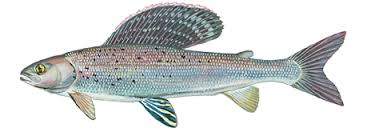

[📥 Grayling data (.csv)](data/gray_I3_I8.csv){.btn .btn-primary download="gray_I3_I8.csv"} [📥 Grayling data (.xlsx)](data/gray_I3_I8.xlsx){.btn .btn-primary download="gray_I3_I8.xlsx"} [📥 Answer sheet (.docx)](intro_r_answer_sheet.docx){.btn .btn-primary download="intro_r_answer_sheet.docx"}

::: callout-note
## 📚 Where these data come from

**Course field dataset**: Arctic grayling (*Thymallus arcticus*) caught in lakes **I-3 and I-8**, Toolik Lake region, North Slope, Alaska.

**Not a textbook dataset**, so there is no W&S or Gotelli chapter behind it. Both files hold the same data. You read the `.csv` with `read_csv()` and the `.xlsx` with `read_excel()`, the same as the pine needles in class.
:::

{width="60%"}

## The data

168 rows, one row per fish.

| Column | What it is |
|-----------|-------------------------------------------|
| `site` | sampling site number |
| `lake` | `I3` or `I8` |
| `species` | always `arctic grayling` |
| `length_mm` | fork length (mm) |
| `mass_g` | mass (g) |

**The question:** do the fish in the two lakes differ in size?

## How this homework works

Everything here is code from the **Getting Started** and **Wrangling Your Data** skeletons (`01_getting_started.R` and `02_wrangling_data.R`). Keep them open and reuse the code on new data.

- Start a new script, `scripts/hw1_grayling.R`, in your course project, and put both data files in `data/`.
- Work through the Parts in order.
- Answer the ten ✏️ questions on the **answer sheet**. Q9 is your saved figure.

```{r setup}
#| message: false
#| warning: false
library(readxl)
library(tidyverse)
```

------------------------------------------------------------------------

# Part 1 · Set up the project

Make sure your project has `data/`, `scripts/`, `output/` and `figures/` folders, and open it from the `.Rproj` file so the paths below work.

------------------------------------------------------------------------

# Part 2 · Read the data two ways

Read `data/gray_I3_I8.csv` into `gray_df` with `read_csv()`, and `data/gray_I3_I8.xlsx` into `gray_xl_df` with `read_excel()`. Look at both with `head()`, `dim()` and `names()`.

```{r part2}

```

✏️ **Q1.** How many rows and columns does `gray_df` have? Give the type (`<chr>`, `<dbl>`) of each column. Do the two files hold the same data?

------------------------------------------------------------------------

# Part 3 · Pick rows with `filter()`

Use `count()` to get the number of fish in each lake. Then use `filter(is.na(mass_g))` to find any fish with a missing mass.

```{r part3}

```

✏️ **Q2.** How many fish came from each lake?

✏️ **Q3.** How many fish have no mass recorded? Which lake are they from, and how long are they? Why should you find these **before** you calculate a mean mass?

------------------------------------------------------------------------

# Part 4 · Look for duplicate rows

Compare `nrow(gray_df)` with `n_distinct(gray_df)`. Then show the duplicated rows with `filter(duplicated(gray_df))`.

```{r part4}

```

✏️ **Q4.** How many rows are exact duplicates? Two real fish **can** have the same length and mass. Would you delete these rows or keep them, and what would you check before you decided?

------------------------------------------------------------------------

# Part 5 · New columns with `mutate()` and `case_when()`

Add three columns to the data:

- `mass_kg`, the mass in kilograms
- `log_mass`, the natural log of mass
- `size_class`: `"small"` below 250 mm, `"medium"` below 350 mm, and `"large"` otherwise

Then `count(lake, size_class)`.

```{r part5}

```

✏️ **Q5.** Fill in the table of fish per size class. What does the table already tell you about the two lakes?

```
            small    medium    large
I3
I8
```

------------------------------------------------------------------------

# Part 6 · Sort with `arrange()`

Sort the data by `lake`, and within each lake by `length_mm` from longest to shortest.

```{r part6}

```

✏️ **Q6.** What is the length and mass of the longest fish in each lake?

------------------------------------------------------------------------

# Part 7 · The full pipeline, and save it

Write **one** pipeline that makes `gray_clean_df`: drop the fish with no mass, keep only `lake`, `length_mm` and `mass_g`, add `size_class`, and sort it as in Part 6. Save it with `write_csv()` to `output/gray_clean.csv`.

```{r part7}

```

✏️ **Q7.** How many rows does `gray_clean_df` have? Explain the number, starting from 168.

------------------------------------------------------------------------

# Part 8 · Plot it, and save the plot

1.  `length_mm` by `lake` as a boxplot with the points jittered on top, with axis labels that include units.
2.  `mass_g` against `length_mm` as points, with `color = lake`.

Save the first plot with `ggsave()` to `figures/grayling_length.png` (3 × 3 in, 300 dpi).

```{r part8}

```

✏️ **Q8.** Which lake has the longer fish, and which lake's lengths are more spread out? In the mass-against-length plot, is the relationship a straight line? Do the two lakes overlap?

✏️ **Q9.** Paste your saved boxplot (`grayling_length.png`) into the answer sheet.

------------------------------------------------------------------------

# Part 9 · Read your code out loud

✏️ **Q10.** Write out your Part 7 pipeline in words, one step per verb, the way we read pipelines in lecture: "Take `gray_df`, **then** …, **then** …". At each `|>`, say what changed: rows, columns, or order.

------------------------------------------------------------------------

# What to turn in

1.  **The answer sheet** (Word) with Q1–Q10 answered and your boxplot pasted in at Q9.
2.  **Your script**, `hw1_grayling.R`. It must run top to bottom. It is not graded line by line, but an answer your script can't reproduce earns no credit.

**Points:** 30, 3 per question. **3** great: correct and fully explained. **2** good: the right idea with a piece missing or a small error. **1** ok: attempted, but mostly wrong or unexplained. **0**: missing.
