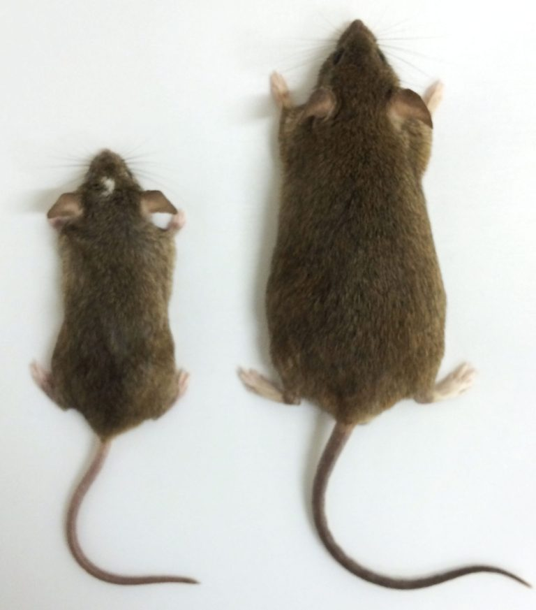

[📥 Mouse data](data/mice_weights.csv){.btn .btn-primary download="mice_weights.csv"} [📥 Answer sheet (.docx)](two_groups_answer_sheet.docx){.btn .btn-primary download="two_groups_answer_sheet.docx"}

::: callout-note
## 📚 Where these data come from

**Course dataset**: body masses of mice from **Sidney Island** (San Juan Islands) and the nearby **Vancouver** mainland, used to test the island rule.

**Not a textbook dataset**, so there is no chapter to look up. The **island rule** (Foster 1964) says small mammals that colonize islands tend to evolve **larger** bodies, probably because islands have fewer predators and competitors. [Background on island syndrome](https://payseur.genetics.wisc.edu/research/research-island-syndrome-and-the-evolution-of-extremes/).
:::

{width="2.84in"}

## The data

62 mice, one row per mouse.

| Column | What it is |
|---------------|-------------------------------------------|
| `sampling_site` | `Sidney Island` or `Vancouver` |
| `location` | `island` or `mainland`: **the two groups** |
| `date_year` | year the mouse was caught |
| `mass_g` | body mass (g): **the response** |

**The question:** are island mice heavier than mainland mice?

## How this homework works

The code is from the **Describing Your Data**, **T-Tests** and **Non-Parametric** skeletons. Reuse it.

- Start a new script, `scripts/hw2_mice.R`, and put the data in `data/`.
- Work through the Parts in order.
- Answer the ten ✏️ questions on the **answer sheet**. Q9 is your final figure.

```{r setup}
#| message: false
#| warning: false
library(car)          # leveneTest()
library(effectsize)   # cohens_d()
library(tidyverse)
```

------------------------------------------------------------------------

# Part 1 · Read and summarize

Read `data/mice_weights.csv` into `mice_df`. Use `count()` to get the mice per `location`, and check for missing masses with `filter(is.na(mass_g))`. Then use `group_by()` and `summarise()` to get the n, mean, standard deviation and standard error of `mass_g` for each location.

```{r part1}

```

✏️ **Q1.** Fill in the table. What did you have to do about the missing value, and how did it change the island n?

```
            n      mean (g)     SD      SE
island
mainland
```

------------------------------------------------------------------------

# Part 2 · Look first

Plot `mass_g` by `location` as a boxplot with the points jittered on top. Then make a histogram of `mass_g` with `facet_wrap(~ location)`.

```{r part2}

```

✏️ **Q2.** Which group looks heavier? Which group is more spread out? Do you see any outliers, or a shape that worries you?

------------------------------------------------------------------------

# Part 3 · One-sample t-tests

Use 19 g as the reference mean for this species. Run a one-sample `t.test()` with `mu = 19` for the island mice, and another for the mainland mice.

```{r part3}

```

✏️ **Q3.** State H₀ for the island test. Report *t*, df and *p* for both tests. Do island mice, mainland mice, or both differ from 19 g?

------------------------------------------------------------------------

# Part 4 · Check the assumptions

Run `shapiro.test()` on `mass_g` for each location separately, and `leveneTest(mass_g ~ location)`.

```{r part4}

```

✏️ **Q4.** Is each group normal? Are the variances equal? Given both answers, should you use Student's t-test (`var.equal = TRUE`) or Welch's (the default)?

------------------------------------------------------------------------

# Part 5 · The two-sample t-test

Run `t.test(mass_g ~ location)` twice: once with `var.equal = TRUE` and once without it. Then get the effect size with `cohens_d(mass_g ~ location)`.

```{r part5}

```

✏️ **Q5.** Report *t*, df and *p* for both versions. Why are the df different? Does the conclusion change?

✏️ **Q6.** How much heavier are island mice, in grams and as a percent of the mainland mean? Give the 95% CI of the difference and Cohen's *d*. Is this a small, medium or large effect?

------------------------------------------------------------------------

# Part 6 · A rank-based check

Run `wilcox.test(mass_g ~ location)`.

```{r part6}

```

✏️ **Q7.** Report *W* and *p*. The Wilcoxon test does not compare **means**. What does it compare? Here it agrees with the t-test. Describe data where you would have had to use it instead.

------------------------------------------------------------------------

# Part 7 · Two years in one group

The mainland mice were caught in **two years**. Filter to the mainland mice and run a t-test of `mass_g` by `date_year`.

```{r part7}

```

✏️ **Q8.** Do the two mainland years differ? Is it reasonable to pool them into one mainland group? What would you worry about if the island mice had all been caught in one year and the mainland mice in another?

------------------------------------------------------------------------

# Part 8 · The final figure

One publication-quality figure: the raw points by location with the **mean ± SE** on top (`stat_summary()`), axis labels with units, and a theme. Save it with `ggsave()`.

```{r part8}

```

✏️ **Q9.** Paste your final figure into the answer sheet.

✏️ **Q10.** Write a 3–4 sentence results paragraph: the means ± SE, which test you used and why, the test result (*t*, df, *p*), and the effect size. End with one sentence on what it means for the island rule.

------------------------------------------------------------------------

# What to turn in

1.  **The answer sheet** (Word) with Q1–Q10 answered and your figure pasted in at Q9.
2.  **Your script**, `hw2_mice.R`. It must run top to bottom. It is not graded line by line, but an answer your script can't reproduce earns no credit.

**Points:** 30, 3 per question. **3** great: correct and fully explained. **2** good: the right idea with a piece missing or a small error. **1** ok: attempted, but mostly wrong or unexplained. **0**: missing.
